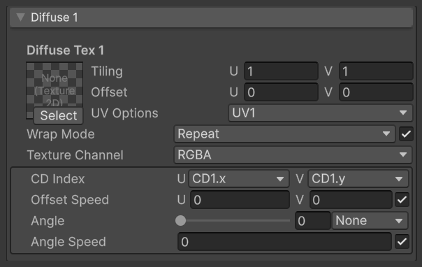
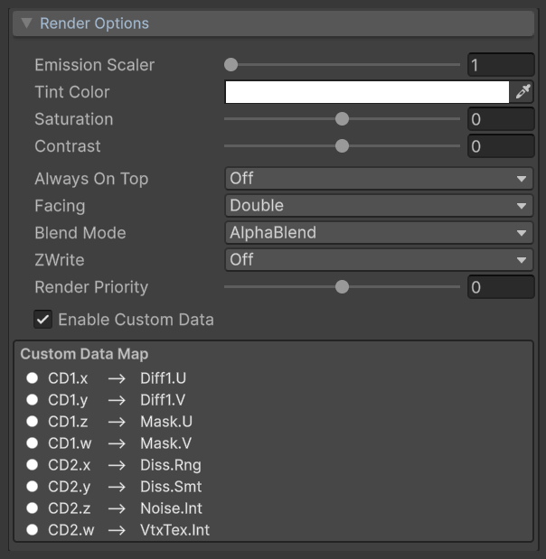
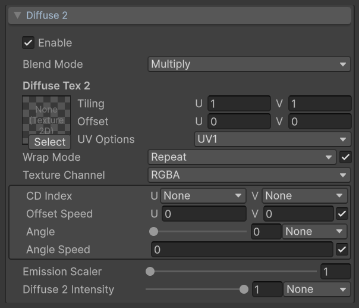
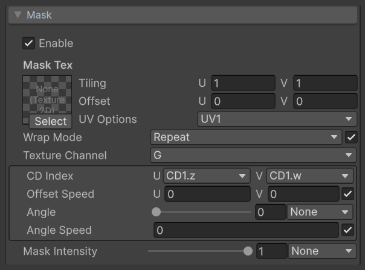
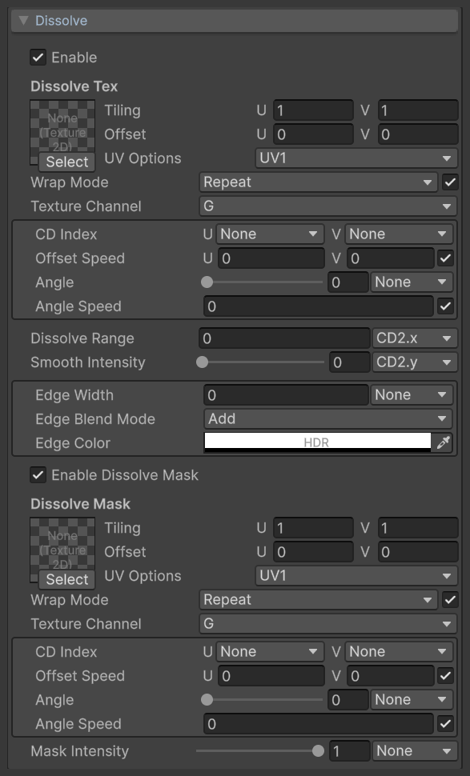
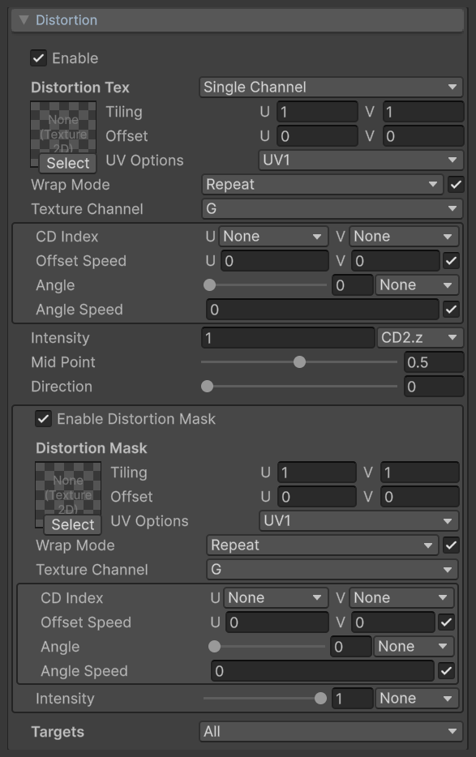
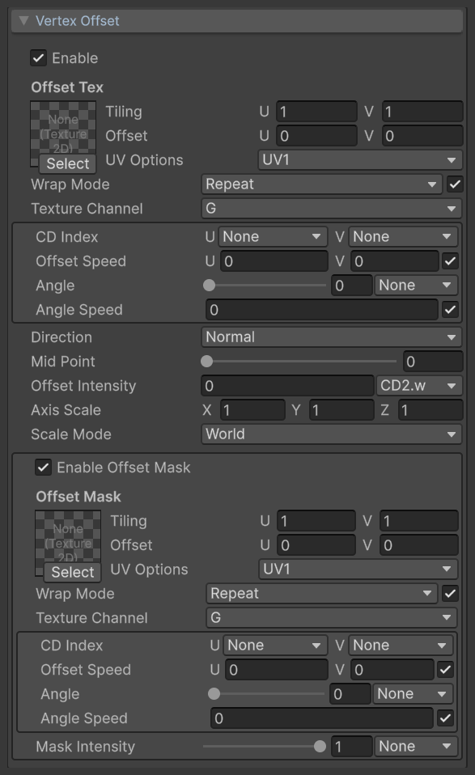
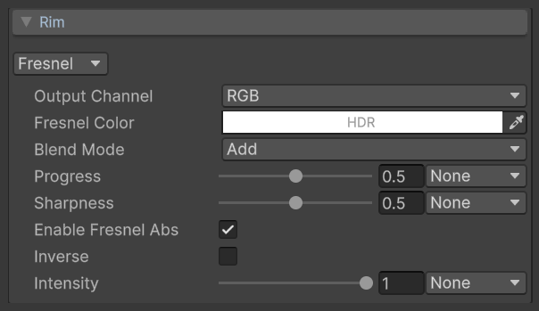
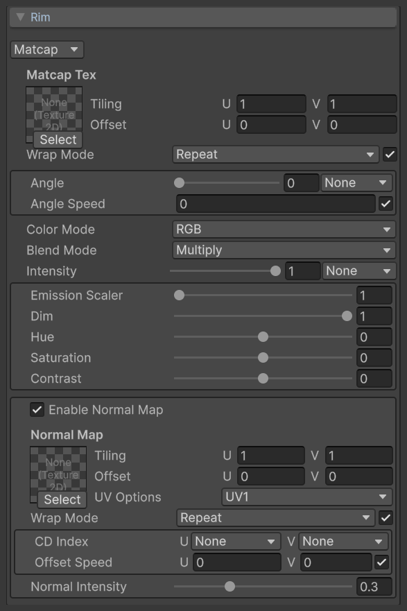
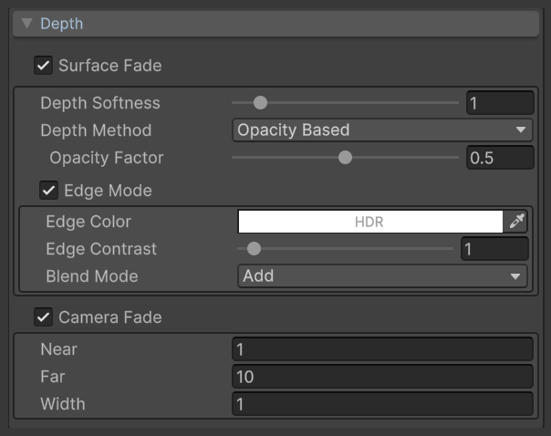

# VFX Essential Shader: Multi-functional shader for Unity visual effects

[](LICENSE.md)
[](#requirements)
[](#requirements)

**Docs** ([English](README.md), [日本語](README_JA.md), [中文](README_ZH.md))

*VFX Essential Shader* is a general-purpose VFX shader for Unity Universal Render Pipeline (URP), suitable for the vast majority of VFX production needs.  
It draws on the author's experience and understanding gained through VFX production, with optimizations and refinements based on established industry practices.

**Key features**

* **Unlit**: No lighting calculations, making it better suited to stylized effects
* **Easy-to-use UI**: An Inspector interface built specifically for artists
* **Designed for Shuriken**: Built to work with the Shuriken particle system (Particle System)

Features include two texture layers, dissolve, masking, UV distortion (including Flow Map), vertex offset, rim lighting (Fresnel / MatCap), soft particles and intersection edges, camera distance fading, and texture wrap modes that can be selected per material.  
Each feature module can be enabled independently. Shader calculations for disabled modules are not executed, and most parameters can be driven by the Particle System's Custom Data.

See below for details on each feature.

> [!NOTE]
> This shader uses shader keywords (`shader_feature`) to toggle features. It has not been optimized for shader variant count, build time or size, or runtime performance. If you use it in a project, adjust it to suit that project's needs.
>
> **AI-Friendly**: The author built this shader's prototype using a node-based shader editor. This release was refactored into hand-written shader code with Claude, retaining comprehensive code comments. A dedicated AI handoff document, [AGENTS.md](AGENTS.md), explains the code structure, design rationale, and caveats. If you want to modify the code through Vibe Coding, you can first ask your AI to read these comments and the document.

## Table of Contents

<details>
<summary>Details</summary>

- [Setup](#setup)
    - [Requirements](#requirements)
    - [Installation](#installation)
- [Usage](#usage)
    - [Texture Import Settings](#texture-import-settings)
    - [Enable Depth Texture](#enable-depth-texture)
    - [Create and Assign a Material](#create-and-assign-a-material)
- [VFX Essential Shader](#vfx-essential-shader)
    - [Common Texture Controls](#common-texture-controls)
    - [Render Options](#render-options)
    - [Diffuse 1](#diffuse-1)
    - [Diffuse 2](#diffuse-2)
    - [Mask](#mask)
    - [Dissolve](#dissolve)
    - [Distortion](#distortion)
    - [Vertex Offset](#vertex-offset)
    - [Rim](#rim)
    - [Depth](#depth)
- [Using Custom Vertex Streams](#using-custom-vertex-streams)
    - [Set Up Custom Data](#set-up-custom-data)
    - [Set Up Custom Vertex Streams](#set-up-custom-vertex-streams)
    - [Set Up Material Properties](#set-up-material-properties)
- [Automatic Custom Vertex Streams Setup](#automatic-custom-vertex-streams-setup)
- [Mesh GPU Instancing](#mesh-gpu-instancing)
- [Order of Operations](#order-of-operations)
- [Limitations](#limitations)
- [License](#license)

</details>

## Setup

#### Requirements
This shader supports the following environments.

* Unity 6 (6000.0 LTS) or later
* Universal Render Pipeline 17
* Forward rendering path

This document assumes that Universal Render Pipeline has already been set up.  
For more information on Universal Render Pipeline, see the [Unity Manual](https://docs.unity3d.com/Packages/com.unity.render-pipelines.universal@17.0/manual/).

#### Installation
Follow these steps to install the shader.

1. Download the latest `.unitypackage` from [Releases](https://github.com/excifroge/VFX-Essential-Shader/releases)
2. In Unity, select Assets > Import Package > Custom Package, choose the downloaded file, and import it

The files are imported into `Assets/VFXEssentialShader`.

Alternatively, clone this repository and copy the `Shaders` and `Editor` folders to any location under your project's `Assets` folder.

## Usage

#### Texture Import Settings
> [!IMPORTANT]
> For the material's Wrap Mode to work correctly, set **Wrap Mode** to **Repeat** in the Import Settings of every texture used with this shader.

If the texture's Import Settings use a different wrap mode, Repeat in the material will not tile correctly.  
For Clamp or Mirror effects, keep the texture's Import Settings at Repeat and select the desired mode in the material's Wrap Mode.

#### Enable Depth Texture
Depth Texture must be enabled to use the features in [Depth](#depth) (soft particles and intersection edges).  
Enable **Depth Texture** in the URP Asset's Inspector.

This setting is unnecessary if you do not use these features.

#### Create and Assign a Material
Create a material and select **VFX > Essential** from the **Shader** dropdown in the Inspector.

Assign the material to the Particle System's Renderer module or to a Mesh Renderer.

To drive material parameters with particle Custom Data or use a second UV set, see [Using Custom Vertex Streams](#using-custom-vertex-streams).

## VFX Essential Shader
VFX Essential Shader is a multi-functional shader unaffected by lighting.

To use it, assign the `VFX/Essential` shader to a material.  
The properties available in the Inspector are described below.

#### Common Texture Controls
Texture slots share a common set of controls, though some slots display only a subset. These controls are described here and are not repeated in the module tables below.

<p align="center">
  <br>
  <font color="grey">Common texture controls (Diffuse 1 shown as an example)</font>
</p>

<table width="100%">
<thead>
<tr><td colspan="3"><b>Property</b></td><td><b>Description</b></td></tr>
</thead>
<tbody>
<tr><td colspan="3"><b>Texture slot</b></td><td>
The texture to sample.
</td></tr>
<tr><td colspan="3"><b>Tiling</b></td><td>
The number of texture repeats along the U and V axes.
</td></tr>
<tr><td colspan="3"><b>Offset</b></td><td>
The texture offset along the U and V axes.
</td></tr>
<tr><td colspan="3"><b>UV Options</b></td><td>
<p>
The UV coordinates used to sample this texture. Select from the following options.
</p>
<p>
<ul>
<li>UV1: The first UV set (default)</li>
<li>UV2: The second UV set</li>
<li>Screen: Screen-space UVs, with the entire screen mapped to 0–1</li>
</ul>
</p>
</td></tr>
<tr><td colspan="3"><b>Wrap Mode</b></td><td>
<p>
Overrides the texture's wrap mode per material. The same texture can use different wrap modes in different materials without being duplicated.
</p>
<p>
<ul>
<li>Repeat: Tiles the texture (default)</li>
<li>Clamp: Extends the edge pixels outside the 0–1 range</li>
<li>Mirror: Mirrors the texture on each repeat</li>
<li>Mirror Once: Mirrors once, then extends the edge pixels</li>
<li>Per-axis: Sets the wrap mode separately for U and V</li>
</ul>
</p>
<p>
The checkbox on the right enables or disables the override. When disabled, the texture uses the wrap mode in its Import Settings.<br>
This feature requires specific texture Import Settings. See <a href="#texture-import-settings">Texture Import Settings</a>.
</p>
</td></tr>
<tr><td></td><td colspan="2"><b>U / V</b></td><td>
<p>
<b>Visible only when Wrap Mode is set to Per-axis.</b>
</p>
<p>
The wrap modes for the U and V axes.
</p>
</td></tr>
<tr><td colspan="3"><b>Texture Channel</b></td><td>
<p>
The texture channel to read: R, G, B, or A. Defaults to G.
</p>
<p>
Diffuse 1 and Diffuse 2 use a different set of Texture Channel options. See <a href="#diffuse-1">Diffuse 1</a>.
</p>
</td></tr>
<tr><td colspan="3"><b>CD Index</b></td><td>
The Custom Data channels used to drive the U and V offsets. Custom Data values are added directly to the UV offsets. See <a href="#using-custom-vertex-streams">Using Custom Vertex Streams</a> for details.
</td></tr>
<tr><td colspan="3"><b>Offset Speed</b></td><td>
<p>
The UV scroll speed along the U and V axes, in UV units per second.<br>
The checkbox on the right enables or disables UV scrolling.
</p>
<p>
When Wrap Mode is Repeat or Mirror, the scroll offset wraps at the texture's repeat period, preventing blocky artifacts caused by limited UV precision after extended runtime.
</p>
</td></tr>
<tr><td colspan="3"><b>Angle</b></td><td>
<p>
The UV rotation angle, from 0 to 360 degrees. The rotation center is UV (0.5, 0.5).<br>
The dropdown on the right selects the Custom Data channel used to drive rotation. Its value is in degrees and is added to this angle.
</p>
</td></tr>
<tr><td colspan="3"><b>Angle Speed</b></td><td>
<p>
The UV rotation speed, in revolutions per second.<br>
The checkbox on the right enables or disables UV rotation.
</p>
</td></tr>
</tbody>
</table>

UV transforms are applied in this order: rotation, then Tiling and Offset, followed by the UV scroll and Custom Data offsets.

#### Render Options
Render Options controls the material's overall color and rendering state.

<p align="center">
  <br>
  <font color="grey">Render Options</font>
</p>

<table width="100%">
<thead>
<tr><td colspan="3"><b>Property</b></td><td><b>Description</b></td></tr>
</thead>
<tbody>
<tr><td colspan="3"><b>Emission Scaler</b></td><td>
<p>
The brightness multiplier for the final color, from 1 to 50.<br>
A value of 1 preserves the original brightness.
</p>
</td></tr>
<tr><td colspan="3"><b>Tint Color</b></td><td>
A color multiplied with the texture and vertex colors. Its Alpha channel controls overall opacity.
</td></tr>
<tr><td colspan="3"><b>Saturation</b></td><td>
The saturation of the final color, from -1 to 1. 0 leaves it unchanged, -1 produces grayscale, and 1 doubles the saturation.
</td></tr>
<tr><td colspan="3"><b>Contrast</b></td><td>
The contrast of the final color, from -1 to 1. 0 leaves it unchanged. This property also affects Alpha.
</td></tr>
<tr><td colspan="3"><b>Always On Top</b></td><td>
<p>
When set to On, bypasses the depth test so the material is not occluded by other objects in the scene.
</p>
<p>
Surface Fade and Edge Mode in <a href="#depth">Depth</a> are unavailable when this is set to On.
</p>
</td></tr>
<tr><td colspan="3"><b>Facing</b></td><td>
<p>
The faces to render. Select from the following options.
</p>
<p>
<ul>
<li>Double: Both sides (default)</li>
<li>Front: Front faces only</li>
<li>Back: Back faces only</li>
</ul>
</p>
<p>
This property is locked to Front when <a href="#rim">Rim</a> is set to Matcap.
</p>
</td></tr>
<tr><td colspan="3"><b>Blend Mode</b></td><td>
<p>
The color blending mode. Select from the following options.
</p>
<p>
<ul>
<li>AlphaBlend: Alpha blending (default)</li>
<li>Add: Additive blending</li>
</ul>
</p>
</td></tr>
<tr><td colspan="3"><b>ZWrite</b></td><td>
Whether to write to the depth buffer.
</td></tr>
<tr><td colspan="3"><b>Render Priority</b></td><td>
<p>
An offset for adjusting the rendering order, from -50 to 50.<br>
The material's Render Queue is 3000 + Render Priority. Higher values render later.
</p>
</td></tr>
<tr><td colspan="3"><b>Enable Custom Data</b></td><td>
<p>
When enabled, the material reads Custom Data and UV2 from the particle's Custom Vertex Streams.<br>
See <a href="#using-custom-vertex-streams">Using Custom Vertex Streams</a> for details.
</p>
</td></tr>
<tr><td></td><td colspan="2"><b>Custom Data Map</b></td><td>
<p>
<b>Visible only when Enable Custom Data is enabled.</b>
</p>
<p>
Lists the parameters currently driven by each Custom Data channel.<br>
A warning is shown in red when multiple parameters use the same channel.
</p>
</td></tr>
</tbody>
</table>

#### Diffuse 1
Diffuse 1 is the material's base color texture.

<p align="center">
  <br>
  <font color="grey">Diffuse 1</font>
</p>

<table width="100%">
<thead>
<tr><td colspan="3"><b>Property</b></td><td><b>Description</b></td></tr>
</thead>
<tbody>
<tr><td colspan="3"><b>Diffuse Tex 1</b></td><td>
The base color texture.
</td></tr>
<tr><td></td><td colspan="2"><b>Texture Channel</b></td><td>
<p>
The texture channels used for color and Alpha. Select from the following options.
</p>
<p>
<ul>
<li>RGBA: Uses RGB for color and A for Alpha (default)</li>
<li>RGB: Uses RGB for color; ignores the texture's Alpha</li>
<li>R: Uses the R channel as grayscale color; ignores the texture's Alpha</li>
<li>A: Uses the A channel for Alpha; ignores the texture's color</li>
<li>R2A: Uses the R channel for Alpha; ignores the texture's color</li>
</ul>
</p>
<p>
An unused output uses a value that does not affect the blend result: 1 (white for color, 1 for Alpha) when Diffuse 2 is disabled or its Blend Mode is Multiply, or 0 when Diffuse 2 is enabled and its Blend Mode is Add. For details, see <a href="#diffuse-2">Diffuse 2</a>.
</p>
</td></tr>
</tbody>
</table>

#### Diffuse 2
Diffuse 2 adds a second texture layer to the base color.

<p align="center">
  <br>
  <font color="grey">Diffuse 2</font>
</p>

<table width="100%">
<thead>
<tr><td colspan="3"><b>Property</b></td><td><b>Description</b></td></tr>
</thead>
<tbody>
<tr><td colspan="3"><b>Enable</b></td><td>
Enables the second texture layer.
</td></tr>
<tr><td colspan="3"><b>Blend Mode</b></td><td>
<p>
How the second layer blends with the base color. Select from the following options.
</p>
<p>
<ul>
<li>Multiply: Multiplies with the base color (default)</li>
<li>Add: Adds to the base color</li>
</ul>
</p>
<p>
Texture Channel determines whether color, Alpha, or both participate in blending. See the table below for the combined results.
</p>
</td></tr>
<tr><td colspan="3"><b>Diffuse Tex 2</b></td><td>
The second texture layer.
</td></tr>
<tr><td></td><td colspan="2"><b>Texture Channel</b></td><td>
<p>
The texture channels used for color and Alpha. The options are the same as Texture Channel in <a href="#diffuse-1">Diffuse 1</a>. Defaults to RGBA.
</p>
<p>
An unused output uses a value that does not affect the blend result: 1 when Blend Mode is Multiply, or 0 when it is Add.
</p>
</td></tr>
<tr><td colspan="3"><b>Emission Scaler</b></td><td>
<p>
The brightness multiplier for the second layer's color, from 1 to 50.<br>
A value of 1 preserves the original brightness.
</p>
</td></tr>
<tr><td colspan="3"><b>Diffuse 2 Intensity</b></td><td>
The second layer's intensity, from 0 to 1. Can be driven by Custom Data.
</td></tr>
</tbody>
</table>

The results of combining Texture Channel and Blend Mode are shown below.

<table width="100%">
<thead>
<tr><td><b>Texture Channel</b></td><td><b>Multiply</b></td><td><b>Add</b></td></tr>
</thead>
<tbody>
<tr><td><b>RGBA</b></td><td>Multiplies color and Alpha</td><td>Adds color weighted by the second layer's Alpha; also adds the second layer's Alpha to the material's Alpha</td></tr>
<tr><td><b>RGB</b></td><td>Multiplies color</td><td>Adds color</td></tr>
<tr><td><b>R</b></td><td>Multiplies color by the R channel's grayscale value</td><td>Adds the R channel's grayscale value to color</td></tr>
<tr><td><b>A</b></td><td>Multiplies Alpha by the A channel</td><td>Adds the A channel to Alpha</td></tr>
<tr><td><b>R2A</b></td><td>Multiplies Alpha by the R channel</td><td>Adds the R channel to Alpha</td></tr>
</tbody>
</table>

In Add mode, the resulting Alpha is clamped to a maximum of 1.

The table above shows the results for the second layer only. Unused outputs in Diffuse 1 likewise use values that do not affect the blend result, so the two layers can supply color and Alpha separately.
For example, with Diffuse 1 set to RGB and Diffuse 2 set to A, color comes from Diffuse 1 and Alpha from Diffuse 2, whether Blend Mode is Multiply or Add.

If an output is unused by both layers, its final value is 1: white for color, 1 for Alpha.

#### Mask
Mask controls opacity using a texture.

<p align="center">
  <br>
  <font color="grey">Mask</font>
</p>

<table width="100%">
<thead>
<tr><td colspan="3"><b>Property</b></td><td><b>Description</b></td></tr>
</thead>
<tbody>
<tr><td colspan="3"><b>Enable</b></td><td>
Enables masking.
</td></tr>
<tr><td colspan="3"><b>Mask Tex</b></td><td>
The mask texture. The selected channel's value is multiplied with Alpha.
</td></tr>
<tr><td colspan="3"><b>Mask Intensity</b></td><td>
The mask intensity, from 0 to 1. 0 disables the mask's effect. Can be driven by Custom Data.
</td></tr>
</tbody>
</table>

#### Dissolve
Dissolve gradually dissolves the material using a texture and can add color along the dissolve boundary.

<p align="center">
  <br>
  <font color="grey">Dissolve</font>
</p>

<table width="100%">
<thead>
<tr><td colspan="3"><b>Property</b></td><td><b>Description</b></td></tr>
</thead>
<tbody>
<tr><td colspan="3"><b>Enable</b></td><td>
Enables dissolve.
</td></tr>
<tr><td colspan="3"><b>Dissolve Tex</b></td><td>
The dissolve texture. Regions with lower values in the selected channel dissolve earlier.
</td></tr>
<tr><td colspan="3"><b>Dissolve Range</b></td><td>
<p>
Dissolve progress. Regions with texture values below this threshold are dissolved.<br>
Can be driven by Custom Data. Defaults to CD2.x.
</p>
</td></tr>
<tr><td colspan="3"><b>Smooth Intensity</b></td><td>
<p>
The transition width at the dissolve boundary, from 0 to 1. 0 produces a hard edge.<br>
Can be driven by Custom Data. Defaults to CD2.y.
</p>
</td></tr>
<tr><td colspan="3"><b>Edge Width</b></td><td>
The width of the dissolve edge band. 0 removes the band. Can be driven by Custom Data.
</td></tr>
<tr><td colspan="3"><b>Edge Blend Mode</b></td><td>
<p>
How the dissolve edge band is rendered. Select from the following options.
</p>
<p>
<ul>
<li>Add: Adds the edge color to the material color (default)</li>
<li>Multiply: Multiplies the material color by the edge color</li>
<li>Tint: Replaces the material color with the edge color. This color is unaffected by Tint Color or vertex color</li>
<li>Select: Keeps only the edge band and removes all other regions</li>
</ul>
</p>
</td></tr>
<tr><td></td><td colspan="2"><b>Edge Color</b></td><td>
<p>
<b>Hidden when Edge Blend Mode is set to Select.</b>
</p>
<p>
The dissolve edge band's color (HDR). Its Alpha channel controls the edge color's intensity.<br>
When Edge Blend Mode is Tint, the Alpha channel controls the band's opacity.
</p>
</td></tr>
<tr><td colspan="3"><b>Enable Dissolve Mask</b></td><td>
Enables the dissolve mask.
</td></tr>
<tr><td></td><td colspan="2"><b>Dissolve Mask</b></td><td>
The dissolve mask texture. Regions with higher values in the selected channel dissolve later.
</td></tr>
<tr><td></td><td colspan="2"><b>Mask Intensity</b></td><td>
The dissolve mask intensity, from 0 to 1. Can be driven by Custom Data.
</td></tr>
</tbody>
</table>

If Smooth Intensity or Edge Width is greater than 0, darker regions of the dissolve texture already show a transition or edge band when Dissolve Range is 0.  
To start with the material completely undissolved, set the initial Dissolve Range to a negative value.

#### Distortion
Distortion uses a texture to distort the UVs of other textures.

<p align="center">
  <br>
  <font color="grey">Distortion</font>
</p>

<table width="100%">
<thead>
<tr><td colspan="3"><b>Property</b></td><td><b>Description</b></td></tr>
</thead>
<tbody>
<tr><td colspan="3"><b>Enable</b></td><td>
Enables UV distortion.
</td></tr>
<tr><td colspan="3"><b>Distortion Tex</b></td><td>
<p>
The distortion texture. Select its type from the dropdown to the right of the heading.
</p>
<p>
<ul>
<li>Single Channel: Uses grayscale values from one channel to distort UVs along Direction (default)</li>
<li>Flow Map: Uses two channels as the distortion amounts along U and V</li>
</ul>
</p>
</td></tr>
<tr><td></td><td colspan="2"><b>Texture Channel</b></td><td>
<p>
<b>Visible only when the type is Single Channel.</b>
</p>
<p>
The channel used as the distortion amount.
</p>
</td></tr>
<tr><td></td><td colspan="2"><b>Channels</b></td><td>
<p>
<b>Visible only when the type is Flow Map.</b>
</p>
<p>
The channels used as the distortion amounts along U and V.
</p>
</td></tr>
<tr><td colspan="3"><b>Intensity</b></td><td>
The distortion intensity. Can be driven by Custom Data. Defaults to CD2.z.
</td></tr>
<tr><td colspan="3"><b>Mid Point</b></td><td>
<p>
<b>Visible only when the type is Single Channel.</b>
</p>
<p>
The grayscale value that represents no distortion, from 0 to 1. Defaults to 0.5.
</p>
</td></tr>
<tr><td colspan="3"><b>Direction</b></td><td>
<p>
<b>Visible only when the type is Single Channel.</b>
</p>
<p>
The distortion direction, from 0 to 360 degrees.
</p>
</td></tr>
<tr><td colspan="3"><b>Enable Distortion Mask</b></td><td>
Enables the distortion mask.
</td></tr>
<tr><td></td><td colspan="2"><b>Distortion Mask</b></td><td>
The distortion mask texture. The selected channel's value is multiplied with the distortion intensity.
</td></tr>
<tr><td></td><td colspan="2"><b>Intensity</b></td><td>
The distortion mask intensity, from 0 to 1. Can be driven by Custom Data.
</td></tr>
<tr><td colspan="3"><b>Targets</b></td><td>
<p>
The textures affected by distortion. Multiple selections are allowed.
</p>
<p>
<ul>
<li>Diffuse 1</li>
<li>Diffuse 2</li>
<li>Mask</li>
<li>Dissolve</li>
<li>Dissolve Mask</li>
<li>Vertex Offset: Offset Tex in <a href="#vertex-offset">Vertex Offset</a></li>
<li>Offset Mask: Offset Mask in <a href="#vertex-offset">Vertex Offset</a></li>
</ul>
</p>
<p>
All targets are selected by default.
</p>
</td></tr>
</tbody>
</table>

The distortion offset is added to the target texture's UVs before rotation and Tiling.  
This keeps distortion consistent across the mesh surface even when the target textures have different rotation angles and Tiling values.

When Vertex Offset or Offset Mask is selected in Targets and Vertex Offset is enabled, the distortion texture is additionally sampled in the vertex shader, and distortion is computed per vertex.

#### Vertex Offset
Vertex Offset moves vertices in the vertex shader based on a texture.

<p align="center">
  <br>
  <font color="grey">Vertex Offset</font>
</p>

<table width="100%">
<thead>
<tr><td colspan="3"><b>Property</b></td><td><b>Description</b></td></tr>
</thead>
<tbody>
<tr><td colspan="3"><b>Enable</b></td><td>
Enables vertex offset.
</td></tr>
<tr><td colspan="3"><b>Offset Tex</b></td><td>
The offset texture. The selected channel's value determines each vertex's offset amount.
</td></tr>
<tr><td colspan="3"><b>Direction</b></td><td>
<p>
The vertex offset direction. Select from the following options.
</p>
<p>
<ul>
<li>Normal: Along each vertex's normal (default)</li>
<li>World: Along the world-space direction specified by Axis Scale</li>
</ul>
</p>
</td></tr>
<tr><td colspan="3"><b>Mid Point</b></td><td>
<p>
The texture value that represents no offset, from 0 to 1. Defaults to 0.<br>
Texture values above this value produce a positive offset; values below it produce a negative offset.
</p>
</td></tr>
<tr><td colspan="3"><b>Offset Intensity</b></td><td>
The offset intensity. Can be driven by Custom Data. Defaults to CD2.w.
</td></tr>
<tr><td colspan="3"><b>Axis Scale</b></td><td>
<p>
When Direction is Normal, scales the offset along the X, Y, and Z axes.
</p>
<p>
When Direction is World, specifies the offset direction vector. This vector is not normalized, so its magnitude also affects the offset amount.
</p>
</td></tr>
<tr><td></td><td colspan="2"><b>Scale Mode</b></td><td>
<p>
<b>Visible only when Direction is set to Normal.</b>
</p>
<p>
The coordinate axes used for the X, Y, and Z components of Axis Scale: World (world space) or Local (object space).
</p>
</td></tr>
<tr><td colspan="3"><b>Enable Offset Mask</b></td><td>
Enables the offset mask.
</td></tr>
<tr><td></td><td colspan="2"><b>Offset Mask</b></td><td>
The offset mask texture. The selected channel's value is multiplied with the offset amount.
</td></tr>
<tr><td></td><td colspan="2"><b>Mask Intensity</b></td><td>
The offset mask intensity, from 0 to 1. Can be driven by Custom Data.
</td></tr>
</tbody>
</table>

The offset amount for each vertex is calculated as follows.

```
Offset amount = (Offset Tex value - Mid Point) × Offset Intensity × Offset Mask
```

#### Rim
Rim adds view-dependent effects to the material.  
Select Off, Fresnel, or Matcap from the dropdown below the heading.

##### Fresnel
Fresnel produces rim lighting based on the angle between the surface normal and the view direction.

<p align="center">
  <br>
  <font color="grey">Rim (Fresnel)</font>
</p>

<table width="100%">
<thead>
<tr><td colspan="3"><b>Property</b></td><td><b>Description</b></td></tr>
</thead>
<tbody>
<tr><td colspan="3"><b>Output Channel</b></td><td>
<p>
How Fresnel is output. Select from the following options.
</p>
<p>
<ul>
<li>RGB: Adds color to the material (default)</li>
<li>A: Multiplies Alpha to make the center or edges of the surface transparent</li>
</ul>
</p>
</td></tr>
<tr><td></td><td colspan="2"><b>Fresnel Color</b></td><td>
<p>
<b>Visible only when Output Channel is set to RGB.</b>
</p>
<p>
The rim light color (HDR). Its Alpha channel controls the rim light intensity.
</p>
</td></tr>
<tr><td></td><td colspan="2"><b>Blend Mode</b></td><td>
<p>
<b>Visible only when Output Channel is set to RGB.</b>
</p>
<p>
How the rim light blends with the material color: Add, Multiply, or Tint (replace).
</p>
</td></tr>
<tr><td colspan="3"><b>Progress</b></td><td>
<p>
The rim light coverage, from 0 to 1.<br>
0 covers the entire surface. Higher values shrink the effect toward the silhouette, and 1 removes it completely. Can be driven by Custom Data.
</p>
</td></tr>
<tr><td colspan="3"><b>Sharpness</b></td><td>
The sharpness of the rim light boundary, from 0 to 1. 1 produces a hard edge. Can be driven by Custom Data.
</td></tr>
<tr><td colspan="3"><b>Enable Fresnel Abs</b></td><td>
When enabled, back faces produce the same rim lighting as front faces. Recommended for double-sided rendering. Enabled by default.
</td></tr>
<tr><td colspan="3"><b>Inverse</b></td><td>
Inverts the rim light so it appears at the center of the surface instead of the silhouette.
</td></tr>
<tr><td colspan="3"><b>Intensity</b></td><td>
The rim light intensity, from 0 to 1. Can be driven by Custom Data.
</td></tr>
</tbody>
</table>

When Output Channel is RGB, rim lighting is composited after Tint Color and vertex color, so its color is unaffected by either.

##### Matcap
Matcap samples a MatCap texture using the view-space normal direction.

<p align="center">
  <br>
  <font color="grey">Rim (Matcap)</font>
</p>

<table width="100%">
<thead>
<tr><td colspan="3"><b>Property</b></td><td><b>Description</b></td></tr>
</thead>
<tbody>
<tr><td colspan="3"><b>Matcap Tex</b></td><td>
The MatCap texture.
</td></tr>
<tr><td colspan="3"><b>Angle</b></td><td>
The MatCap UV rotation angle, from 0 to 360 degrees. Can be driven by Custom Data.
</td></tr>
<tr><td colspan="3"><b>Angle Speed</b></td><td>
<p>
The MatCap UV rotation speed, in revolutions per second.<br>
The checkbox on the right enables or disables UV rotation.
</p>
</td></tr>
<tr><td colspan="3"><b>Color Mode</b></td><td>
<p>
The information to use from the MatCap texture. Select from the following options.
</p>
<p>
<ul>
<li>RGB: Uses color (default)</li>
<li>Grayscale: Converts color to grayscale before use</li>
<li>RGBA: Uses color and Alpha</li>
<li>RGBtoA: Converts color to grayscale and affects only the material's Alpha, leaving its color unchanged</li>
</ul>
</p>
</td></tr>
<tr><td colspan="3"><b>Blend Mode</b></td><td>
<p>
How MatCap blends with the material: Multiply (default) or Add.<br>
See the table below for the results of combining this with Color Mode.
</p>
</td></tr>
<tr><td colspan="3"><b>Intensity</b></td><td>
The MatCap intensity, from 0 to 1. Can be driven by Custom Data.
</td></tr>
<tr><td colspan="3"><b>Emission Scaler</b></td><td>
The brightness multiplier for the MatCap color, from 1 to 50. A value of 1 preserves the original brightness.
</td></tr>
<tr><td colspan="3"><b>Dim</b></td><td>
<p>
<b>Visible only when Blend Mode is set to Multiply.</b>
</p>
<p>
The darkening factor for the MatCap color, from 0 to 1.
</p>
</td></tr>
<tr><td colspan="3"><b>Hue</b></td><td>
The hue shift of the MatCap color, from -180 to 180 degrees.
</td></tr>
<tr><td colspan="3"><b>Saturation</b></td><td>
The saturation of the MatCap color, from -1 to 1. 0 leaves it unchanged.
</td></tr>
<tr><td colspan="3"><b>Contrast</b></td><td>
The contrast of the MatCap color, from -1 to 1. 0 leaves it unchanged.
</td></tr>
<tr><td colspan="3"><b>Enable Normal Map</b></td><td>
<p>
Enables a normal map to perturb the normals used to sample MatCap.
</p>
<p>
The shader computes the tangent direction per pixel, so the Tangent Vertex Stream is not required when used with a Particle System.
</p>
</td></tr>
<tr><td></td><td colspan="2"><b>Normal Map</b></td><td>
A tangent-space normal map. Supports CD Index and Offset Speed, but not rotation.
</td></tr>
<tr><td></td><td colspan="2"><b>Normal Intensity</b></td><td>
The normal map intensity, from 0 to 1. Defaults to 0.3.
</td></tr>
</tbody>
</table>

The results of combining Color Mode and Blend Mode are shown below.

<table width="100%">
<thead>
<tr><td><b>Color Mode</b></td><td><b>Multiply</b></td><td><b>Add</b></td></tr>
</thead>
<tbody>
<tr><td><b>RGB / Grayscale</b></td><td>Multiplies color</td><td>Adds color</td></tr>
<tr><td><b>RGBA</b></td><td>Multiplies color and Alpha</td><td>Adds color and adds MatCap Alpha to the material's Alpha</td></tr>
<tr><td><b>RGBtoA</b></td><td>Multiplies Alpha by grayscale</td><td>Adds grayscale to Alpha</td></tr>
</tbody>
</table>

When Rim is set to Matcap, Facing in Render Options is locked to Front. Switching to another mode restores the previous setting.

#### Depth
Depth provides depth-based effects. Surface Fade and Edge Mode require [Depth Texture to be enabled](#enable-depth-texture); Camera Fade does not.

Surface Fade and Edge Mode are unavailable when Always On Top in Render Options is set to On.

<p align="center">
  <br>
  <font color="grey">Depth</font>
</p>

<table width="100%">
<thead>
<tr><td colspan="3"><b>Property</b></td><td><b>Description</b></td></tr>
</thead>
<tbody>
<tr><td colspan="3"><b>Surface Fade</b></td><td>
When enabled, the material fades out near opaque surfaces in the scene, avoiding hard edges where particles intersect geometry (soft particles).
</td></tr>
<tr><td></td><td colspan="2"><b>Depth Softness</b></td><td>
<p>
The fade distance, from 0.01 to 10. Higher values increase the fade range.<br>
When Edge Mode is enabled, this property determines the intersection edge range.
</p>
</td></tr>
<tr><td></td><td colspan="2"><b>Depth Method</b></td><td>
<p>
How the fade distance is calculated. Select from the following options.
</p>
<p>
<ul>
<li>Simple: Uses the same Depth Softness for all pixels (default)</li>
<li>Opacity Based: Uses a longer fade distance for more transparent pixels</li>
</ul>
</p>
</td></tr>
<tr><td></td><td></td><td><b>Opacity Factor</b></td><td>
<p>
<b>Visible only when Depth Method is set to Opacity Based.</b>
</p>
<p>
How much to extend the fade distance for transparent pixels, from 0 to 1.
</p>
</td></tr>
<tr><td></td><td colspan="2"><b>Edge Mode</b></td><td>
When enabled, displays an edge color where the material intersects scene surfaces instead of fading out.
</td></tr>
<tr><td></td><td></td><td><b>Edge Color</b></td><td>
The intersection edge color (HDR). Its Alpha channel controls the edge intensity.
</td></tr>
<tr><td></td><td></td><td><b>Edge Contrast</b></td><td>
The intersection edge falloff, from 0.1 to 20. Higher values produce a wider, fuller edge; lower values produce a thinner edge with faster falloff.
</td></tr>
<tr><td></td><td></td><td><b>Blend Mode</b></td><td>
<p>
How the edge color blends with the material color: Add, Multiply, or Tint (replace).<br>
In Tint mode, the edge color is unaffected by Saturation and Contrast.
</p>
</td></tr>
<tr><td colspan="3"><b>Camera Fade</b></td><td>
When enabled, the material fades based on its distance from the camera.
</td></tr>
<tr><td></td><td colspan="2"><b>Near</b></td><td>
Regions closer to the camera than this distance are fully transparent.
</td></tr>
<tr><td></td><td colspan="2"><b>Far</b></td><td>
Regions farther from the camera than this distance are fully transparent.
</td></tr>
<tr><td></td><td colspan="2"><b>Width</b></td><td>
The transition distance for fading in and out at Near and Far.
</td></tr>
</tbody>
</table>

Intersection edges remain visible in transparent regions of the texture, but disappear with particle fading, dissolve, and masking.  
When Edge Mode is enabled, Fresnel rim lighting is suppressed at intersection edges.

## Using Custom Vertex Streams
The Particle System's Custom Vertex Streams let you drive material parameters with Custom Data and use a second UV set.

These settings are unnecessary for a Mesh Renderer. Keep Enable Custom Data disabled; UV2 is then read from the mesh's second UV set.

#### Set Up Custom Data
In the Particle System's Custom Data module, set Mode to Vector for both Custom1 and Custom2, with 4 components each.

#### Set Up Custom Vertex Streams
Enable Custom Vertex Streams in the Particle System's Renderer module and configure the streams in the order shown below.

<table width="100%">
<thead>
<tr><td><b>Order</b></td><td><b>Vertex Stream</b></td><td><b>Semantic</b></td><td><b>Purpose</b></td></tr>
</thead>
<tbody>
<tr><td>1</td><td>Position</td><td>POSITION</td><td>Vertex position</td></tr>
<tr><td>2</td><td>Normal</td><td>NORMAL</td><td>Normal. Required for Rim and Vertex Offset</td></tr>
<tr><td>3</td><td>Color</td><td>COLOR</td><td>Particle color</td></tr>
<tr><td>4</td><td>UV</td><td>TEXCOORD0.xy</td><td>First UV set (UV1)</td></tr>
<tr><td>5</td><td>UV2</td><td>TEXCOORD0.zw</td><td>Second UV set (UV2)</td></tr>
<tr><td>6</td><td>Custom1.xyzw</td><td>TEXCOORD1.xyzw</td><td>Custom Data 1 (CD1)</td></tr>
<tr><td>7</td><td>Custom2.xyzw</td><td>TEXCOORD2.xyzw</td><td>Custom Data 2 (CD2)</td></tr>
</tbody>
</table>

Among Vertex Streams that use TEXCOORD, UV, UV2, Custom1, and Custom2 must come first in the order shown above. Any other streams that use TEXCOORD must follow them.  
Unity does not report an error if this order is incorrect, but the material will read the wrong data.

#### Set Up Material Properties
Turn on Enable Custom Data in the material's Render Options.

Parameters with a Custom Data dropdown can then be driven by Custom Data.  
In the dropdown, CD1.x through CD1.w correspond to Custom1's X, Y, Z, and W components, and CD2.x through CD2.w correspond to Custom2's X, Y, Z, and W components. None disables Custom Data for that parameter.

A parameter's final value is the sum of its material value and its Custom Data value.

```
Final value = Material value + Custom Data value
```

With the Particle System's Custom Data kept at 0, toggling Enable Custom Data does not change the material's appearance.  
To control a parameter entirely through Custom Data, set its material value to 0.

For intensity parameters with a 0–1 range, the sum is clamped to 0–1, except for the Dissolve Mask's Mask Intensity and the Fresnel parameters.

The following parameters have Custom Data channels assigned by default.

<table width="100%">
<thead>
<tr><td><b>Custom Data channel</b></td><td><b>Parameter driven by default</b></td></tr>
</thead>
<tbody>
<tr><td>CD1.x</td><td>Diffuse Tex 1 U offset</td></tr>
<tr><td>CD1.y</td><td>Diffuse Tex 1 V offset</td></tr>
<tr><td>CD1.z</td><td>Mask Tex U offset</td></tr>
<tr><td>CD1.w</td><td>Mask Tex V offset</td></tr>
<tr><td>CD2.x</td><td>Dissolve Range</td></tr>
<tr><td>CD2.y</td><td>Smooth Intensity</td></tr>
<tr><td>CD2.z</td><td>Distortion Intensity</td></tr>
<tr><td>CD2.w</td><td>Offset Intensity</td></tr>
</tbody>
</table>

## Automatic Custom Vertex Streams Setup
When Enable Custom Data is enabled, the material's Inspector shows a warning if a Particle System using this material in the scene has Vertex Streams that do not match the requirements.  
Particle Systems using [Mesh GPU Instancing](#mesh-gpu-instancing) are checked regardless of whether Enable Custom Data is enabled.

Click **Fix Vertex Streams** to correct them automatically. Required streams are placed first in the correct order, and other existing streams are preserved after them.  
For Particle Systems using Mesh GPU Instancing, per-particle vertex streams are replaced with the required streams, and any other per-particle vertex streams are removed.

## Mesh GPU Instancing
When a Particle System's Render Mode is Mesh and Enable Mesh GPU Instancing is enabled in its Renderer module, this shader automatically renders the particles using GPU Instancing. No material settings are required.

When using Mesh GPU Instancing, Position, Normal, UV, UV2, and similar data come from the mesh's own vertex data. The remaining vertex streams are supplied per particle.
When Custom Vertex Streams is enabled, the per-particle vertex streams must match the table below exactly, including their order. No additional per-particle vertex streams are allowed.

<table width="100%">
<thead>
<tr><td><b>Enable Custom Data</b></td><td><b>Per-particle vertex streams</b></td></tr>
</thead>
<tbody>
<tr><td>Disabled</td><td>Color, AnimFrame</td></tr>
<tr><td>Enabled</td><td>Color, Custom1.xyzw, Custom2.xyzw, AnimFrame</td></tr>
</tbody>
</table>

No setup is required when Custom Vertex Streams is disabled in the Renderer module and Enable Custom Data is disabled.

Unity does not report an error if the vertex streams do not match, but the material will read the wrong data. Use the [Fix Vertex Streams](#automatic-custom-vertex-streams-setup) button in the Inspector to correct them.

When using Mesh GPU Instancing, Texture Sheet Animation affects only UV1.

## Order of Operations
The shader calculates the final color in the following order.

1. Calculate the Distortion offset
2. Sample Diffuse 1 and blend Diffuse 2
3. Apply Dissolve and Mask
4. Apply Rim (Fresnel A output or Matcap)
5. Multiply by vertex color and Tint Color, then apply Emission Scaler
6. Apply the Dissolve Tint edge color
7. Apply Fresnel RGB output
8. Apply Surface Fade or the Edge Mode Add or Multiply edge color
9. Apply Saturation and Contrast
10. Apply the Edge Mode Tint edge color
11. Apply Camera Fade

## Limitations
* Fog is not supported
* Frame blending in Texture Sheet Animation is not supported
* UI Mask and RectMask2D are not supported
* XR Single Pass Instanced rendering is not supported

## License
This software is released under the MIT License.  
You may use it freely within the terms of the license. You must retain the copyright and license notices provided below.

* [LICENSE.md](LICENSE.md)
