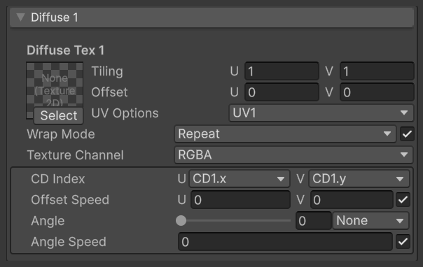
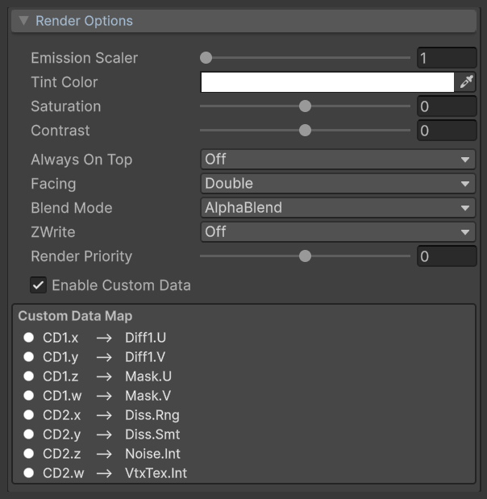
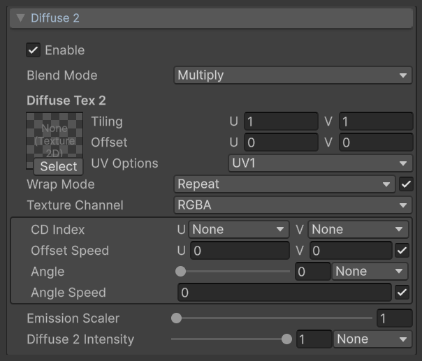
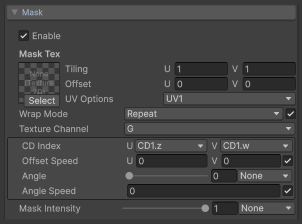
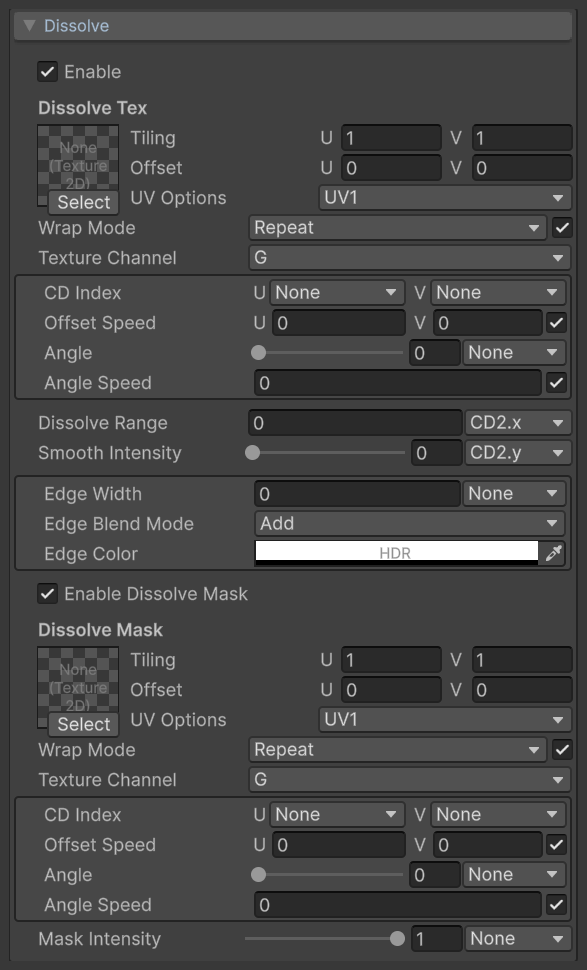
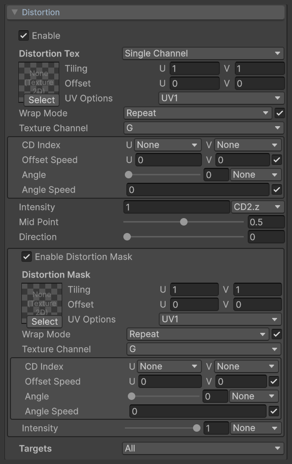
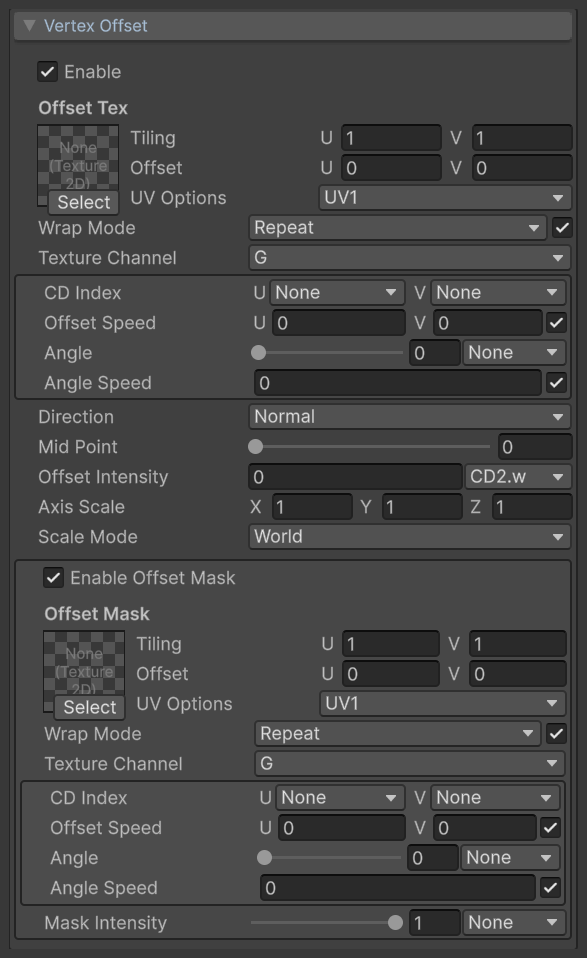
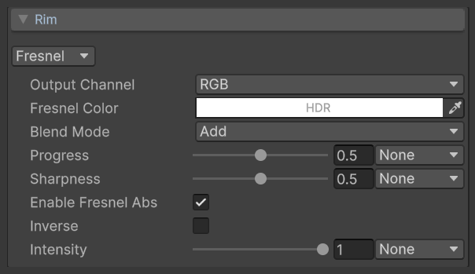
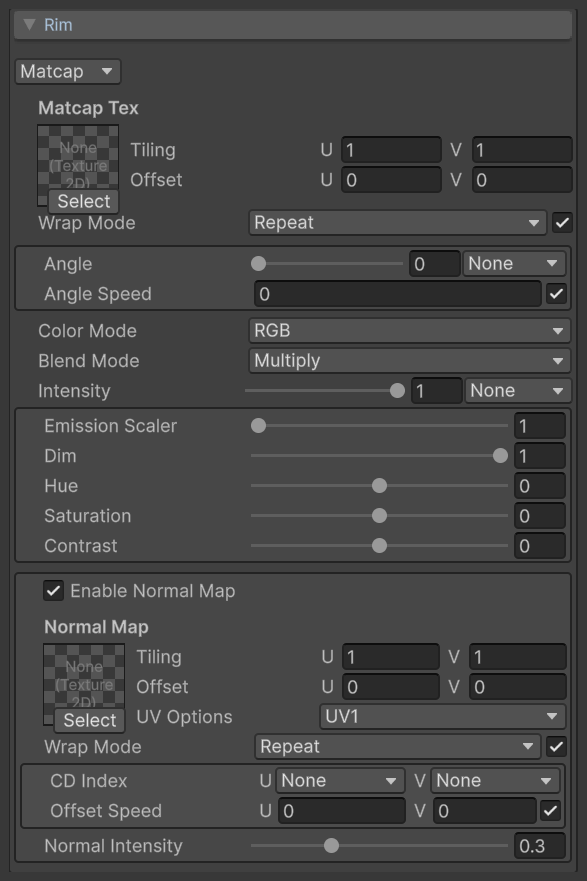
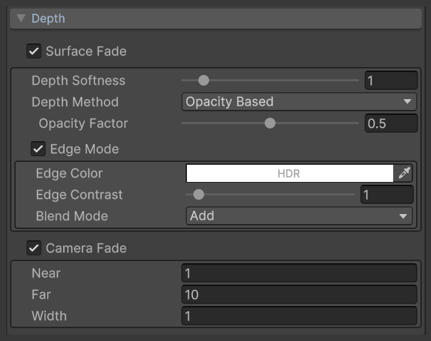

# VFX Essential Shader: Unityエフェクト用多機能シェーダー

[](LICENSE.md)
[](#動作環境)
[](#動作環境)

**ドキュメント** ([English](README.md), [日本語](README_JA.md), [中文](README_ZH.md))

*VFX Essential Shader*は、Unity Universal Render Pipeline (URP)向けの汎用エフェクトシェーダーで、エフェクト制作のほとんどの場面で使用できます。  
作者がエフェクト制作を通じて培った経験と理解をもとに、業界で一般的な手法や慣例に沿って最適化・調整しています。

**主な特徴**

* **Unlit**：ライティング計算を行わず、スタイライズされたエフェクトにより適しています
* **使いやすいUI**：アーティスト向けに設計したInspector
* **Shurikenとの連携**：Shurikenパーティクルシステム (Particle System)と組み合わせて使うことを前提に設計しています

主な機能は、2層のテクスチャ、ディゾルブ、マスク、UVディストーション（Flow Map対応）、頂点オフセット、リムライト（Fresnel / MatCap）、ソフトパーティクルと交差部分のエッジ、カメラからの距離に応じたフェード、マテリアルごとに切り替えられるテクスチャのラップモードです。  
各機能モジュールは個別に有効化できます。無効なモジュールのシェーダー計算は実行されません。また、ほとんどのパラメーターをParticle SystemのCustom Dataで制御できます。

各機能の詳細は以下を参照してください。

> [!NOTE]
> 本シェーダーはシェーダーキーワード (`shader_feature`)で機能を切り替えます。シェーダーバリアント数、ビルド時間・サイズ、実行時のパフォーマンスについては最適化していません。プロジェクトで使用する場合は、プロジェクトに合わせて調整してください。
>
> **AI-Friendly**：本シェーダーのプロトタイプは、作者がノードベースのシェーダー編集ツールで構築しました。本リリースではClaudeを使って手書きのシェーダーコードにリファクタリングし、コードには詳しい英語のコメントを残しています。また、コードの構造、設計意図、注意事項を説明するAI向けの引き継ぎドキュメント [AGENTS.md](AGENTS.md)（英語）も用意しています。Vibe Codingでコードを変更したい場合は、まず自分のAIにこれらのコメントとドキュメントを読ませてください。

## 目次

<details>
<summary>詳細</summary>

- [セットアップ](#セットアップ)
    - [動作環境](#動作環境)
    - [インストール](#インストール)
- [使い方](#使い方)
    - [テクスチャのインポート設定](#テクスチャのインポート設定)
    - [Depth Textureを有効化](#depth-textureを有効化)
    - [マテリアルの作成と割り当て](#マテリアルの作成と割り当て)
- [VFX Essential Shader](#vfx-essential-shader)
    - [テクスチャの共通コントロール](#テクスチャの共通コントロール)
    - [Render Options](#render-options)
    - [Diffuse 1](#diffuse-1)
    - [Diffuse 2](#diffuse-2)
    - [Mask](#mask)
    - [Dissolve](#dissolve)
    - [Distortion](#distortion)
    - [Vertex Offset](#vertex-offset)
    - [Rim](#rim)
    - [Depth](#depth)
- [Custom Vertex Streamsとの連携](#custom-vertex-streamsとの連携)
    - [Custom Dataの設定](#custom-dataの設定)
    - [Custom Vertex Streamsの設定](#custom-vertex-streamsの設定)
    - [マテリアルプロパティの設定](#マテリアルプロパティの設定)
- [Custom Vertex Streamsの自動設定](#custom-vertex-streamsの自動設定)
- [Mesh GPU Instancing](#mesh-gpu-instancing)
- [処理順序](#処理順序)
- [制限事項](#制限事項)
- [ライセンス](#ライセンス)

</details>

## セットアップ

#### 動作環境
本シェーダーは以下の環境に対応しています。

* Unity 6 (6000.0 LTS) 以上
* Universal Render Pipeline 17
* Forwardレンダリングパス

本ドキュメントでは、Universal Render Pipelineのセットアップが完了していることを前提としています。  
Universal Render Pipelineの詳細は、[Unityのマニュアル](https://docs.unity3d.com/Packages/com.unity.render-pipelines.universal@17.0/manual/)を参照してください。

#### インストール
以下の手順でインストールします。

1. [Releases](https://github.com/excifroge/VFX-Essential-Shader/releases)から最新の`.unitypackage`をダウンロード
2. UnityでAssets > Import Package > Custom Packageを選択し、ダウンロードしたファイルを指定してインポート

ファイルは`Assets/VFXEssentialShader`フォルダーにインポートされます。

本リポジトリをクローンし、`Shaders`と`Editor`の2つのフォルダーをプロジェクトの`Assets`フォルダー内の任意の場所にコピーすることもできます。

## 使い方

#### テクスチャのインポート設定
> [!IMPORTANT]
> マテリアルのWrap Modeを正しく動作させるには、本シェーダーで使用するすべてのテクスチャのImport Settingsで**Wrap Mode**を**Repeat**に設定してください。

テクスチャのImport Settingsが別のラップモードになっていると、マテリアルのRepeatでは正しく繰り返せません。  
ClampやMirrorの効果が必要な場合も、Import SettingsはRepeatのままにし、マテリアルのWrap Modeで対応するモードを選択してください。

#### Depth Textureを有効化
[Depth](#depth)の機能（ソフトパーティクル、交差部分のエッジ）を使うには、Depth Textureを有効にする必要があります。  
URP AssetのInspectorで**Depth Texture**にチェックを入れます。

これらの機能を使わない場合、この設定は不要です。

#### マテリアルの作成と割り当て
マテリアルを作成し、Inspectorの**Shader**ドロップダウンから**VFX > Essential**を選択します。

マテリアルをParticle SystemのRendererモジュール、またはMesh Rendererに割り当てます。

パーティクルのCustom Dataでマテリアルのパラメーターを制御する場合や、2つ目のUVセットを使う場合は、[Custom Vertex Streamsとの連携](#custom-vertex-streamsとの連携)を参照してください。

## VFX Essential Shader
VFX Essential Shaderは、ライティングの影響を受けない多機能シェーダーです。

マテリアルに`VFX/Essential`シェーダーを割り当てて使用します。  
Inspectorで設定できる各プロパティを以下に説明します。

#### テクスチャの共通コントロール
各テクスチャスロットは共通のコントロールを使用しますが、一部のスロットではその一部のみが表示されます。ここでまとめて説明し、以降の各モジュールの表では説明を省略します。

<p align="center">
  <br>
  <font color="grey">テクスチャの共通コントロール（Diffuse 1の例）</font>
</p>

<table width="100%">
<thead>
<tr><td colspan="3"><b>プロパティ</b></td><td><b>説明</b></td></tr>
</thead>
<tbody>
<tr><td colspan="3"><b>テクスチャスロット</b></td><td>
サンプリングするテクスチャ。
</td></tr>
<tr><td colspan="3"><b>Tiling</b></td><td>
U、V方向のテクスチャの繰り返し回数。
</td></tr>
<tr><td colspan="3"><b>Offset</b></td><td>
U、V方向のテクスチャのオフセット量。
</td></tr>
<tr><td colspan="3"><b>UV Options</b></td><td>
<p>
このテクスチャのサンプリングに使うUV座標を、以下から選択します。
</p>
<p>
<ul>
<li>UV1: 1つ目のUVセット（デフォルト）</li>
<li>UV2: 2つ目のUVセット</li>
<li>Screen: スクリーン空間のUV。画面全体が0～1に対応</li>
</ul>
</p>
</td></tr>
<tr><td colspan="3"><b>Wrap Mode</b></td><td>
<p>
マテリアルごとにテクスチャのラップモードを上書きします。テクスチャを複製せずに、同じテクスチャを複数のマテリアルで異なるラップモードで使用できます。
</p>
<p>
<ul>
<li>Repeat: テクスチャを繰り返す（デフォルト）</li>
<li>Clamp: 0～1の範囲外では端のピクセルを引き伸ばす</li>
<li>Mirror: 繰り返すたびにテクスチャを鏡像反転する</li>
<li>Mirror Once: 1回だけ鏡像反転し、その先は端のピクセルを引き伸ばす</li>
<li>Per-axis: U、V方向のラップモードを個別に指定する</li>
</ul>
</p>
<p>
右側のチェックボックスで上書きの有効・無効を切り替えます。無効の場合は、テクスチャのImport Settingsのラップモードを使用します。<br>
この機能を使うには、テクスチャのImport Settingsに条件があります。<a href="#テクスチャのインポート設定">テクスチャのインポート設定</a>を参照してください。
</p>
</td></tr>
<tr><td></td><td colspan="2"><b>U / V</b></td><td>
<p>
<b>Wrap ModeをPer-axisに設定した場合のみ表示されます。</b>
</p>
<p>
U、V方向それぞれのラップモード。
</p>
</td></tr>
<tr><td colspan="3"><b>Texture Channel</b></td><td>
<p>
値を読み取るテクスチャのチャンネルをR、G、B、Aから選択します。デフォルトはGです。
</p>
<p>
Diffuse 1とDiffuse 2のTexture Channelでは別の選択肢を使用します。<a href="#diffuse-1">Diffuse 1</a>を参照してください。
</p>
</td></tr>
<tr><td colspan="3"><b>CD Index</b></td><td>
U、V方向のオフセットを制御するCustom Dataのチャンネル。Custom Dataの値はUVオフセットに直接加算されます。詳細は<a href="#custom-vertex-streamsとの連携">Custom Vertex Streamsとの連携</a>を参照してください。
</td></tr>
<tr><td colspan="3"><b>Offset Speed</b></td><td>
<p>
U、V方向のUVスクロール速度。単位はUV単位/秒です。<br>
右側のチェックボックスでUVスクロールの有効・無効を切り替えます。
</p>
<p>
Wrap ModeがRepeatまたはMirrorの場合、スクロールのオフセットをテクスチャの繰り返し周期で折り返します。これにより、長時間実行してもUVの精度不足によるブロック状のアーティファクトを防ぎます。
</p>
</td></tr>
<tr><td colspan="3"><b>Angle</b></td><td>
<p>
UVの回転角度。範囲は0～360度で、回転の中心はUVの(0.5, 0.5)です。<br>
右側のドロップダウンで回転を制御するCustom Dataのチャンネルを指定します。Custom Dataの値は度単位で、この角度に加算されます。
</p>
</td></tr>
<tr><td colspan="3"><b>Angle Speed</b></td><td>
<p>
UVの回転速度。単位は回転数/秒です。<br>
右側のチェックボックスでUV回転の有効・無効を切り替えます。
</p>
</td></tr>
</tbody>
</table>

UVは、回転、TilingとOffset、UVスクロールとCustom Dataのオフセット加算の順に変換されます。

#### Render Options
Render Optionsでは、マテリアル全体の色とレンダリングステートを設定します。

<p align="center">
  <br>
  <font color="grey">Render Options</font>
</p>

<table width="100%">
<thead>
<tr><td colspan="3"><b>プロパティ</b></td><td><b>説明</b></td></tr>
</thead>
<tbody>
<tr><td colspan="3"><b>Emission Scaler</b></td><td>
<p>
最終色の明るさの倍率。範囲は1～50です。<br>
1の場合は元の明るさを維持します。
</p>
</td></tr>
<tr><td colspan="3"><b>Tint Color</b></td><td>
テクスチャの色と頂点カラーに乗算する色。Alphaチャンネルで全体の不透明度を制御します。
</td></tr>
<tr><td colspan="3"><b>Saturation</b></td><td>
最終色の彩度。範囲は-1～1です。0では変化せず、-1でグレースケール、1で彩度が2倍になります。
</td></tr>
<tr><td colspan="3"><b>Contrast</b></td><td>
最終色のコントラスト。範囲は-1～1で、0では変化しません。Alphaにも適用されます。
</td></tr>
<tr><td colspan="3"><b>Always On Top</b></td><td>
<p>
Onにすると深度テストをスキップし、マテリアルがシーン内の他のオブジェクトに遮られなくなります。
</p>
<p>
Onの場合、<a href="#depth">Depth</a>のSurface FadeとEdge Modeは使用できません。
</p>
</td></tr>
<tr><td colspan="3"><b>Facing</b></td><td>
<p>
レンダリングする面を、以下から選択します。
</p>
<p>
<ul>
<li>Double: 両面（デフォルト）</li>
<li>Front: 表面のみ</li>
<li>Back: 裏面のみ</li>
</ul>
</p>
<p>
<a href="#rim">Rim</a>がMatcapの場合、このプロパティはFrontに固定されます。
</p>
</td></tr>
<tr><td colspan="3"><b>Blend Mode</b></td><td>
<p>
色のブレンド方法を、以下から選択します。
</p>
<p>
<ul>
<li>AlphaBlend: アルファブレンド（デフォルト）</li>
<li>Add: 加算ブレンド</li>
</ul>
</p>
</td></tr>
<tr><td colspan="3"><b>ZWrite</b></td><td>
深度バッファーへの書き込みの有無。
</td></tr>
<tr><td colspan="3"><b>Render Priority</b></td><td>
<p>
描画順を調整するオフセット値。範囲は-50～50です。<br>
マテリアルのRender Queueは3000 + Render Priorityです。値が大きいほど後に描画されます。
</p>
</td></tr>
<tr><td colspan="3"><b>Enable Custom Data</b></td><td>
<p>
有効にすると、パーティクルのCustom Vertex StreamsからCustom DataとUV2を読み取ります。<br>
詳細は<a href="#custom-vertex-streamsとの連携">Custom Vertex Streamsとの連携</a>を参照してください。
</p>
</td></tr>
<tr><td></td><td colspan="2"><b>Custom Data Map</b></td><td>
<p>
<b>Enable Custom Dataが有効な場合のみ表示されます。</b>
</p>
<p>
各Custom Dataチャンネルが現在制御しているパラメーターを一覧表示します。<br>
同じチャンネルを複数のパラメーターで使用している場合、赤色で警告を表示します。
</p>
</td></tr>
</tbody>
</table>

#### Diffuse 1
Diffuse 1は、マテリアルのベースカラーとなるテクスチャです。

<p align="center">
  <br>
  <font color="grey">Diffuse 1</font>
</p>

<table width="100%">
<thead>
<tr><td colspan="3"><b>プロパティ</b></td><td><b>説明</b></td></tr>
</thead>
<tbody>
<tr><td colspan="3"><b>Diffuse Tex 1</b></td><td>
ベースカラーのテクスチャ。
</td></tr>
<tr><td></td><td colspan="2"><b>Texture Channel</b></td><td>
<p>
色とAlphaに使うテクスチャのチャンネルを、以下から選択します。
</p>
<p>
<ul>
<li>RGBA: RGBを色、AをAlphaとして使用（デフォルト）</li>
<li>RGB: RGBを色として使用。テクスチャのAlphaは使用しない</li>
<li>R: Rチャンネルをグレースケールの色として使用。テクスチャのAlphaは使用しない</li>
<li>A: AチャンネルをAlphaとして使用。テクスチャの色は使用しない</li>
<li>R2A: RチャンネルをAlphaとして使用。テクスチャの色は使用しない</li>
</ul>
</p>
<p>
使用しない項目には、ブレンド結果に影響しない値を使用します。Diffuse 2が無効、またはそのBlend ModeがMultiplyの場合は1（色は白、Alphaは1）、Diffuse 2が有効でBlend ModeがAddの場合は0です。詳細は<a href="#diffuse-2">Diffuse 2</a>を参照してください。
</p>
</td></tr>
</tbody>
</table>

#### Diffuse 2
Diffuse 2は、ベースカラーに2層目のテクスチャを重ねます。

<p align="center">
  <br>
  <font color="grey">Diffuse 2</font>
</p>

<table width="100%">
<thead>
<tr><td colspan="3"><b>プロパティ</b></td><td><b>説明</b></td></tr>
</thead>
<tbody>
<tr><td colspan="3"><b>Enable</b></td><td>
2層目のテクスチャを有効にします。
</td></tr>
<tr><td colspan="3"><b>Blend Mode</b></td><td>
<p>
2層目とベースカラーのブレンド方法を、以下から選択します。
</p>
<p>
<ul>
<li>Multiply: ベースカラーに乗算（デフォルト）</li>
<li>Add: ベースカラーに加算</li>
</ul>
</p>
<p>
色、Alpha、またはその両方のどれをブレンドするかはTexture Channelで決まります。組み合わせによる結果は以下の表を参照してください。
</p>
</td></tr>
<tr><td colspan="3"><b>Diffuse Tex 2</b></td><td>
2層目のテクスチャ。
</td></tr>
<tr><td></td><td colspan="2"><b>Texture Channel</b></td><td>
<p>
色とAlphaに使うテクスチャのチャンネル。選択肢は<a href="#diffuse-1">Diffuse 1</a>のTexture Channelと同じで、デフォルトはRGBAです。
</p>
<p>
使用しない項目には、ブレンド結果に影響しない値を使用します。Blend ModeがMultiplyの場合は1、Addの場合は0です。
</p>
</td></tr>
<tr><td colspan="3"><b>Emission Scaler</b></td><td>
<p>
2層目の色の明るさの倍率。範囲は1～50です。<br>
1の場合は元の明るさを維持します。
</p>
</td></tr>
<tr><td colspan="3"><b>Diffuse 2 Intensity</b></td><td>
2層目の強度。範囲は0～1です。Custom Dataで制御できます。
</td></tr>
</tbody>
</table>

Texture ChannelとBlend Modeの組み合わせによる結果は以下のとおりです。

<table width="100%">
<thead>
<tr><td><b>Texture Channel</b></td><td><b>Multiply</b></td><td><b>Add</b></td></tr>
</thead>
<tbody>
<tr><td><b>RGBA</b></td><td>色とAlphaを乗算</td><td>2層目のAlphaを重みとして色を加算し、2層目のAlphaもマテリアルのAlphaに加算</td></tr>
<tr><td><b>RGB</b></td><td>色を乗算</td><td>色を加算</td></tr>
<tr><td><b>R</b></td><td>Rチャンネルのグレースケール値を色に乗算</td><td>Rチャンネルのグレースケール値を色に加算</td></tr>
<tr><td><b>A</b></td><td>AチャンネルをAlphaに乗算</td><td>AチャンネルをAlphaに加算</td></tr>
<tr><td><b>R2A</b></td><td>RチャンネルをAlphaに乗算</td><td>RチャンネルをAlphaに加算</td></tr>
</tbody>
</table>

Addでは、加算後のAlphaは最大1にクランプされます。

上表は2層目側の結果を示しています。Diffuse 1で使用しない項目にも同様にブレンド結果に影響しない値を使うため、色とAlphaを別々の層から取得できます。
例えばDiffuse 1がRGB、Diffuse 2がAの場合、Blend ModeがMultiplyでもAddでも、色はDiffuse 1から、AlphaはDiffuse 2から取得されます。

両方の層で使用しない項目の最終値は1です。色は白、Alphaは1です。

#### Mask
Maskは、テクスチャを使って不透明度を制御します。

<p align="center">
  <br>
  <font color="grey">Mask</font>
</p>

<table width="100%">
<thead>
<tr><td colspan="3"><b>プロパティ</b></td><td><b>説明</b></td></tr>
</thead>
<tbody>
<tr><td colspan="3"><b>Enable</b></td><td>
マスクを有効にします。
</td></tr>
<tr><td colspan="3"><b>Mask Tex</b></td><td>
マスクテクスチャ。選択したチャンネルの値をAlphaに乗算します。
</td></tr>
<tr><td colspan="3"><b>Mask Intensity</b></td><td>
マスクの強度。範囲は0～1で、0ではマスクの効果がなくなります。Custom Dataで制御できます。
</td></tr>
</tbody>
</table>

#### Dissolve
Dissolveは、テクスチャを使ってマテリアルを徐々にディゾルブさせます。ディゾルブの境界に色を付けることもできます。

<p align="center">
  <br>
  <font color="grey">Dissolve</font>
</p>

<table width="100%">
<thead>
<tr><td colspan="3"><b>プロパティ</b></td><td><b>説明</b></td></tr>
</thead>
<tbody>
<tr><td colspan="3"><b>Enable</b></td><td>
ディゾルブを有効にします。
</td></tr>
<tr><td colspan="3"><b>Dissolve Tex</b></td><td>
ディゾルブテクスチャ。選択したチャンネルの値が小さい部分ほど先にディゾルブします。
</td></tr>
<tr><td colspan="3"><b>Dissolve Range</b></td><td>
<p>
ディゾルブの進行度。テクスチャの値がこの値を下回る部分がディゾルブします。<br>
Custom Dataで制御できます。デフォルトではCD2.xに割り当てられています。
</p>
</td></tr>
<tr><td colspan="3"><b>Smooth Intensity</b></td><td>
<p>
ディゾルブ境界の遷移幅。範囲は0～1で、0では硬いエッジになります。<br>
Custom Dataで制御できます。デフォルトではCD2.yに割り当てられています。
</p>
</td></tr>
<tr><td colspan="3"><b>Edge Width</b></td><td>
ディゾルブ境界の帯の幅。0では帯がなくなります。Custom Dataで制御できます。
</td></tr>
<tr><td colspan="3"><b>Edge Blend Mode</b></td><td>
<p>
ディゾルブ境界の帯の表示方法を、以下から選択します。
</p>
<p>
<ul>
<li>Add: エッジの色をマテリアルの色に加算（デフォルト）</li>
<li>Multiply: エッジの色をマテリアルの色に乗算</li>
<li>Tint: マテリアルの色をエッジの色で置き換える。この色はTint Colorと頂点カラーの影響を受けない</li>
<li>Select: 境界の帯だけを残し、それ以外の部分をすべて非表示にする</li>
</ul>
</p>
</td></tr>
<tr><td></td><td colspan="2"><b>Edge Color</b></td><td>
<p>
<b>Edge Blend ModeがSelectの場合は表示されません。</b>
</p>
<p>
ディゾルブ境界の帯の色 (HDR)。Alphaチャンネルでエッジの色の強度を制御します。<br>
Edge Blend ModeがTintの場合、Alphaチャンネルは帯の不透明度を制御します。
</p>
</td></tr>
<tr><td colspan="3"><b>Enable Dissolve Mask</b></td><td>
ディゾルブマスクを有効にします。
</td></tr>
<tr><td></td><td colspan="2"><b>Dissolve Mask</b></td><td>
ディゾルブマスクのテクスチャ。選択したチャンネルの値が大きい部分ほど遅くディゾルブします。
</td></tr>
<tr><td></td><td colspan="2"><b>Mask Intensity</b></td><td>
ディゾルブマスクの強度。範囲は0～1です。Custom Dataで制御できます。
</td></tr>
</tbody>
</table>

Smooth IntensityまたはEdge Widthが0より大きい場合、Dissolve Rangeが0でも、ディゾルブテクスチャの暗い部分に遷移や境界の帯が現れます。  
まったくディゾルブしていない状態から始めるには、Dissolve Rangeの初期値を負の値に設定してください。

#### Distortion
Distortionは、テクスチャを使って他のテクスチャのUVを歪ませます。

<p align="center">
  <br>
  <font color="grey">Distortion</font>
</p>

<table width="100%">
<thead>
<tr><td colspan="3"><b>プロパティ</b></td><td><b>説明</b></td></tr>
</thead>
<tbody>
<tr><td colspan="3"><b>Enable</b></td><td>
UVディストーションを有効にします。
</td></tr>
<tr><td colspan="3"><b>Distortion Tex</b></td><td>
<p>
ディストーションテクスチャ。見出しの右側のドロップダウンでテクスチャの種類を選択します。
</p>
<p>
<ul>
<li>Single Channel: 単一チャンネルのグレースケール値を使い、Directionで指定した方向にUVを歪ませる（デフォルト）</li>
<li>Flow Map: 2つのチャンネルをU、V方向それぞれのディストーション量として使用</li>
</ul>
</p>
</td></tr>
<tr><td></td><td colspan="2"><b>Texture Channel</b></td><td>
<p>
<b>種類がSingle Channelの場合のみ表示されます。</b>
</p>
<p>
ディストーション量として使うチャンネル。
</p>
</td></tr>
<tr><td></td><td colspan="2"><b>Channels</b></td><td>
<p>
<b>種類がFlow Mapの場合のみ表示されます。</b>
</p>
<p>
U、V方向それぞれのディストーション量として使うチャンネル。
</p>
</td></tr>
<tr><td colspan="3"><b>Intensity</b></td><td>
ディストーションの強度。Custom Dataで制御できます。デフォルトではCD2.zに割り当てられています。
</td></tr>
<tr><td colspan="3"><b>Mid Point</b></td><td>
<p>
<b>種類がSingle Channelの場合のみ表示されます。</b>
</p>
<p>
ディストーションが発生しない基準となるグレースケール値。範囲は0～1で、デフォルトは0.5です。
</p>
</td></tr>
<tr><td colspan="3"><b>Direction</b></td><td>
<p>
<b>種類がSingle Channelの場合のみ表示されます。</b>
</p>
<p>
ディストーションの方向。範囲は0～360度です。
</p>
</td></tr>
<tr><td colspan="3"><b>Enable Distortion Mask</b></td><td>
ディストーションマスクを有効にします。
</td></tr>
<tr><td></td><td colspan="2"><b>Distortion Mask</b></td><td>
ディストーションマスクのテクスチャ。選択したチャンネルの値をディストーションの強度に乗算します。
</td></tr>
<tr><td></td><td colspan="2"><b>Intensity</b></td><td>
ディストーションマスクの強度。範囲は0～1です。Custom Dataで制御できます。
</td></tr>
<tr><td colspan="3"><b>Targets</b></td><td>
<p>
ディストーションを適用するテクスチャ。複数選択できます。
</p>
<p>
<ul>
<li>Diffuse 1</li>
<li>Diffuse 2</li>
<li>Mask</li>
<li>Dissolve</li>
<li>Dissolve Mask</li>
<li>Vertex Offset: <a href="#vertex-offset">Vertex Offset</a>のOffset Tex</li>
<li>Offset Mask: <a href="#vertex-offset">Vertex Offset</a>のOffset Mask</li>
</ul>
</p>
<p>
デフォルトではすべて選択されています。
</p>
</td></tr>
</tbody>
</table>

ディストーションのオフセットは、対象テクスチャの回転とTilingより前にUVに加算されます。  
そのため、対象テクスチャごとに回転角度やTilingが異なっていても、メッシュ表面では同じ歪みが適用されます。

TargetsでVertex OffsetまたはOffset Maskを選択し、Vertex Offsetが有効な場合、頂点シェーダーでもディストーションテクスチャを追加でサンプリングし、ディストーション量を頂点ごとに計算します。

#### Vertex Offset
Vertex Offsetは、テクスチャに基づいて頂点シェーダーで頂点を移動させます。

<p align="center">
  <br>
  <font color="grey">Vertex Offset</font>
</p>

<table width="100%">
<thead>
<tr><td colspan="3"><b>プロパティ</b></td><td><b>説明</b></td></tr>
</thead>
<tbody>
<tr><td colspan="3"><b>Enable</b></td><td>
頂点オフセットを有効にします。
</td></tr>
<tr><td colspan="3"><b>Offset Tex</b></td><td>
オフセットテクスチャ。選択したチャンネルの値が各頂点のオフセット量を決めます。
</td></tr>
<tr><td colspan="3"><b>Direction</b></td><td>
<p>
頂点のオフセット方向を、以下から選択します。
</p>
<p>
<ul>
<li>Normal: 各頂点の法線方向（デフォルト）</li>
<li>World: Axis Scaleで指定したワールド空間の方向</li>
</ul>
</p>
</td></tr>
<tr><td colspan="3"><b>Mid Point</b></td><td>
<p>
オフセットが発生しない基準となるテクスチャの値。範囲は0～1で、デフォルトは0です。<br>
テクスチャの値がこの値より大きいと正方向に、小さいと逆方向にオフセットします。
</p>
</td></tr>
<tr><td colspan="3"><b>Offset Intensity</b></td><td>
オフセットの強度。Custom Dataで制御できます。デフォルトではCD2.wに割り当てられています。
</td></tr>
<tr><td colspan="3"><b>Axis Scale</b></td><td>
<p>
DirectionがNormalの場合、X、Y、Z各軸のオフセットの倍率を指定します。
</p>
<p>
DirectionがWorldの場合、オフセットの方向ベクトルを指定します。このベクトルは正規化されないため、長さもオフセット量に影響します。
</p>
</td></tr>
<tr><td></td><td colspan="2"><b>Scale Mode</b></td><td>
<p>
<b>DirectionをNormalに設定した場合のみ表示されます。</b>
</p>
<p>
Axis ScaleのX、Y、Zが対応する座標軸。World（ワールド空間）またはLocal（オブジェクト空間）を指定します。
</p>
</td></tr>
<tr><td colspan="3"><b>Enable Offset Mask</b></td><td>
オフセットマスクを有効にします。
</td></tr>
<tr><td></td><td colspan="2"><b>Offset Mask</b></td><td>
オフセットマスクのテクスチャ。選択したチャンネルの値をオフセット量に乗算します。
</td></tr>
<tr><td></td><td colspan="2"><b>Mask Intensity</b></td><td>
オフセットマスクの強度。範囲は0～1です。Custom Dataで制御できます。
</td></tr>
</tbody>
</table>

各頂点のオフセット量は以下のように計算されます。

```
オフセット量 = (Offset Texの値 - Mid Point) × Offset Intensity × Offset Mask
```

#### Rim
Rimは、視点に応じた効果をマテリアルに追加します。  
見出しの下のドロップダウンでOff、Fresnel、Matcapからモードを選択します。

##### Fresnel
Fresnelは、サーフェスの法線と視線方向の角度に基づいてリムライトを生成します。

<p align="center">
  <br>
  <font color="grey">Rim（Fresnel）</font>
</p>

<table width="100%">
<thead>
<tr><td colspan="3"><b>プロパティ</b></td><td><b>説明</b></td></tr>
</thead>
<tbody>
<tr><td colspan="3"><b>Output Channel</b></td><td>
<p>
Fresnelの出力方法を、以下から選択します。
</p>
<p>
<ul>
<li>RGB: 色としてマテリアルに加算（デフォルト）</li>
<li>A: Alphaに乗算し、サーフェスの中心やエッジを透明にする</li>
</ul>
</p>
</td></tr>
<tr><td></td><td colspan="2"><b>Fresnel Color</b></td><td>
<p>
<b>Output ChannelをRGBに設定した場合のみ表示されます。</b>
</p>
<p>
リムライトの色 (HDR)。Alphaチャンネルでリムライトの強度を制御します。
</p>
</td></tr>
<tr><td></td><td colspan="2"><b>Blend Mode</b></td><td>
<p>
<b>Output ChannelをRGBに設定した場合のみ表示されます。</b>
</p>
<p>
リムライトとマテリアルの色のブレンド方法。Add（加算）、Multiply（乗算）、Tint（置き換え）から選択します。
</p>
</td></tr>
<tr><td colspan="3"><b>Progress</b></td><td>
<p>
リムライトの範囲。値の範囲は0～1です。<br>
0ではサーフェス全体を覆います。値が大きいほど輪郭に向かって範囲が狭まり、1では完全に消えます。Custom Dataで制御できます。
</p>
</td></tr>
<tr><td colspan="3"><b>Sharpness</b></td><td>
リムライトの境界のシャープさ。範囲は0～1で、1では硬いエッジになります。Custom Dataで制御できます。
</td></tr>
<tr><td colspan="3"><b>Enable Fresnel Abs</b></td><td>
有効にすると、裏面にも表面と同じリムライトが生成されます。両面描画時は有効にすることを推奨します。デフォルトで有効です。
</td></tr>
<tr><td colspan="3"><b>Inverse</b></td><td>
リムライトを反転し、輪郭ではなくサーフェスの中心に表示します。
</td></tr>
<tr><td colspan="3"><b>Intensity</b></td><td>
リムライトの強度。範囲は0～1です。Custom Dataで制御できます。
</td></tr>
</tbody>
</table>

Output ChannelがRGBの場合、リムライトはTint Colorと頂点カラーの適用後に合成されるため、その色は両者の影響を受けません。

##### Matcap
Matcapは、ビュー空間の法線方向を使ってMatCapテクスチャをサンプリングします。

<p align="center">
  <br>
  <font color="grey">Rim（Matcap）</font>
</p>

<table width="100%">
<thead>
<tr><td colspan="3"><b>プロパティ</b></td><td><b>説明</b></td></tr>
</thead>
<tbody>
<tr><td colspan="3"><b>Matcap Tex</b></td><td>
MatCapテクスチャ。
</td></tr>
<tr><td colspan="3"><b>Angle</b></td><td>
MatCapのUVの回転角度。範囲は0～360度です。Custom Dataで制御できます。
</td></tr>
<tr><td colspan="3"><b>Angle Speed</b></td><td>
<p>
MatCapのUVの回転速度。単位は回転数/秒です。<br>
右側のチェックボックスでUV回転の有効・無効を切り替えます。
</p>
</td></tr>
<tr><td colspan="3"><b>Color Mode</b></td><td>
<p>
MatCapテクスチャから使用する情報を、以下から選択します。
</p>
<p>
<ul>
<li>RGB: 色を使用（デフォルト）</li>
<li>Grayscale: 色をグレースケールに変換して使用</li>
<li>RGBA: 色とAlphaを使用</li>
<li>RGBtoA: 色をグレースケールに変換し、マテリアルのAlphaのみに適用。マテリアルの色は変更しない</li>
</ul>
</p>
</td></tr>
<tr><td colspan="3"><b>Blend Mode</b></td><td>
<p>
MatCapとマテリアルのブレンド方法。Multiply（デフォルト）またはAddから選択します。<br>
Color Modeとの組み合わせによる結果は、以下の表を参照してください。
</p>
</td></tr>
<tr><td colspan="3"><b>Intensity</b></td><td>
MatCapの強度。範囲は0～1です。Custom Dataで制御できます。
</td></tr>
<tr><td colspan="3"><b>Emission Scaler</b></td><td>
MatCapの色の明るさの倍率。範囲は1～50です。1の場合は元の明るさを維持します。
</td></tr>
<tr><td colspan="3"><b>Dim</b></td><td>
<p>
<b>Blend ModeをMultiplyに設定した場合のみ表示されます。</b>
</p>
<p>
MatCapの色を暗くする係数。範囲は0～1です。
</p>
</td></tr>
<tr><td colspan="3"><b>Hue</b></td><td>
MatCapの色の色相シフト。範囲は-180～180度です。
</td></tr>
<tr><td colspan="3"><b>Saturation</b></td><td>
MatCapの色の彩度。範囲は-1～1で、0では変化しません。
</td></tr>
<tr><td colspan="3"><b>Contrast</b></td><td>
MatCapの色のコントラスト。範囲は-1～1で、0では変化しません。
</td></tr>
<tr><td colspan="3"><b>Enable Normal Map</b></td><td>
<p>
MatCapのサンプリングに使う法線を変化させるためのノーマルマップを有効にします。
</p>
<p>
接線方向はシェーダーがピクセルごとに計算するため、Particle Systemで使用する場合もTangent Vertex Streamの追加は不要です。
</p>
</td></tr>
<tr><td></td><td colspan="2"><b>Normal Map</b></td><td>
タンジェント空間のノーマルマップ。CD IndexとOffset Speedに対応していますが、回転には対応していません。
</td></tr>
<tr><td></td><td colspan="2"><b>Normal Intensity</b></td><td>
ノーマルマップの強度。範囲は0～1で、デフォルトは0.3です。
</td></tr>
</tbody>
</table>

Color ModeとBlend Modeの組み合わせによる結果は以下のとおりです。

<table width="100%">
<thead>
<tr><td><b>Color Mode</b></td><td><b>Multiply</b></td><td><b>Add</b></td></tr>
</thead>
<tbody>
<tr><td><b>RGB / Grayscale</b></td><td>色を乗算</td><td>色を加算</td></tr>
<tr><td><b>RGBA</b></td><td>色とAlphaを乗算</td><td>色を加算し、MatCapのAlphaをマテリアルのAlphaに加算</td></tr>
<tr><td><b>RGBtoA</b></td><td>グレースケール値をAlphaに乗算</td><td>グレースケール値をAlphaに加算</td></tr>
</tbody>
</table>

RimがMatcapの場合、Render OptionsのFacingはFrontに固定されます。他のモードに切り替えると、以前の設定に戻ります。

#### Depth
Depthは、深度に基づく効果を提供します。Surface FadeとEdge Modeを使うには、[Depth Textureを有効化](#depth-textureを有効化)する必要があります。Camera Fadeには不要です。

Render OptionsのAlways On TopがOnの場合、Surface FadeとEdge Modeは使用できません。

<p align="center">
  <br>
  <font color="grey">Depth</font>
</p>

<table width="100%">
<thead>
<tr><td colspan="3"><b>プロパティ</b></td><td><b>説明</b></td></tr>
</thead>
<tbody>
<tr><td colspan="3"><b>Surface Fade</b></td><td>
有効にすると、シーン内の不透明なサーフェスに近い部分でマテリアルがフェードアウトします。パーティクルとジオメトリの交差部分に硬いエッジが生じるのを防ぎます（ソフトパーティクル）。
</td></tr>
<tr><td></td><td colspan="2"><b>Depth Softness</b></td><td>
<p>
フェードする距離。範囲は0.01～10で、値が大きいほどフェードの範囲が広がります。<br>
Edge Modeが有効な場合、交差部分のエッジの範囲を決めます。
</p>
</td></tr>
<tr><td></td><td colspan="2"><b>Depth Method</b></td><td>
<p>
フェード距離の計算方法を、以下から選択します。
</p>
<p>
<ul>
<li>Simple: すべてのピクセルに同じDepth Softnessを使用（デフォルト）</li>
<li>Opacity Based: 透明なピクセルほど長いフェード距離を使用</li>
</ul>
</p>
</td></tr>
<tr><td></td><td></td><td><b>Opacity Factor</b></td><td>
<p>
<b>Depth MethodをOpacity Basedに設定した場合のみ表示されます。</b>
</p>
<p>
透明なピクセルのフェード距離を延ばす度合い。範囲は0～1です。
</p>
</td></tr>
<tr><td></td><td colspan="2"><b>Edge Mode</b></td><td>
有効にすると、シーンのサーフェスと交差する部分に、フェードの代わりにエッジの色を表示します。
</td></tr>
<tr><td></td><td></td><td><b>Edge Color</b></td><td>
交差部分のエッジの色 (HDR)。Alphaチャンネルでエッジの強度を制御します。
</td></tr>
<tr><td></td><td></td><td><b>Edge Contrast</b></td><td>
交差部分のエッジの減衰。範囲は0.1～20です。値が大きいほど、エッジは幅広くなり、広い範囲で高い強度を保ちます。値が小さいほど細くなり、減衰も速くなります。
</td></tr>
<tr><td></td><td></td><td><b>Blend Mode</b></td><td>
<p>
エッジの色とマテリアルの色のブレンド方法。Add（加算）、Multiply（乗算）、Tint（置き換え）から選択します。<br>
Tintの場合、エッジの色はSaturationとContrastの影響を受けません。
</p>
</td></tr>
<tr><td colspan="3"><b>Camera Fade</b></td><td>
有効にすると、カメラからの距離に応じてマテリアルがフェードします。
</td></tr>
<tr><td></td><td colspan="2"><b>Near</b></td><td>
カメラからの距離がこの値より小さい部分は完全に透明になります。
</td></tr>
<tr><td></td><td colspan="2"><b>Far</b></td><td>
カメラからの距離がこの値より大きい部分は完全に透明になります。
</td></tr>
<tr><td></td><td colspan="2"><b>Width</b></td><td>
NearとFarの両端でフェードイン・フェードアウトする遷移距離。
</td></tr>
</tbody>
</table>

交差部分のエッジはテクスチャの透明な部分にも表示されますが、パーティクルのフェード、ディゾルブ、マスクに合わせて消えます。  
Edge Modeが有効な場合、交差部分のエッジではFresnelのリムライトが抑制されます。

## Custom Vertex Streamsとの連携
Particle SystemのCustom Vertex Streamsを使うと、Custom Dataでマテリアルのパラメーターを制御し、2つ目のUVセットも使用できます。

Mesh Rendererではこれらの設定は不要です。Enable Custom Dataは無効のままにしてください。この場合、UV2はメッシュの2つ目のUVセットから取得されます。

#### Custom Dataの設定
Particle SystemのCustom Dataモジュールで、Custom1とCustom2のModeをVectorにし、それぞれの成分数を4に設定します。

#### Custom Vertex Streamsの設定
Particle SystemのRendererモジュールでCustom Vertex Streamsを有効にし、以下の表の順に設定します。

<table width="100%">
<thead>
<tr><td><b>順序</b></td><td><b>Vertex Stream</b></td><td><b>セマンティクス</b></td><td><b>用途</b></td></tr>
</thead>
<tbody>
<tr><td>1</td><td>Position</td><td>POSITION</td><td>頂点位置</td></tr>
<tr><td>2</td><td>Normal</td><td>NORMAL</td><td>法線。RimとVertex Offsetで必要</td></tr>
<tr><td>3</td><td>Color</td><td>COLOR</td><td>パーティクルの色</td></tr>
<tr><td>4</td><td>UV</td><td>TEXCOORD0.xy</td><td>1つ目のUVセット (UV1)</td></tr>
<tr><td>5</td><td>UV2</td><td>TEXCOORD0.zw</td><td>2つ目のUVセット (UV2)</td></tr>
<tr><td>6</td><td>Custom1.xyzw</td><td>TEXCOORD1.xyzw</td><td>Custom Data 1 (CD1)</td></tr>
<tr><td>7</td><td>Custom2.xyzw</td><td>TEXCOORD2.xyzw</td><td>Custom Data 2 (CD2)</td></tr>
</tbody>
</table>

TEXCOORDを使用するVertex Streamの中では、UV、UV2、Custom1、Custom2を上表の順に先頭に並べる必要があります。それ以外のTEXCOORDを使用するVertex Streamは、必ずこれらの後に配置してください。  
順序が異なっていてもUnityはエラーを出しませんが、マテリアルは誤ったデータを読み取ります。

#### マテリアルプロパティの設定
マテリアルのRender OptionsでEnable Custom Dataを有効にします。

これにより、Custom DataのドロップダウンがあるパラメーターをCustom Dataで制御できるようになります。  
ドロップダウンのCD1.x～CD1.wはCustom1のX、Y、Z、Wに、CD2.x～CD2.wはCustom2のX、Y、Z、Wに対応します。Noneでは、そのパラメーターにCustom Dataを使用しません。

パラメーターの最終値は、マテリアルに設定した値とCustom Dataの値の合計です。

```
最終値 = マテリアルの値 + Custom Dataの値
```

Particle SystemのCustom Dataが0のままであれば、Enable Custom Dataの有効・無効を切り替えても、マテリアルの見た目は変わりません。  
パラメーターをCustom Dataだけで制御するには、マテリアル側の対応する値を0に設定してください。

範囲が0～1の強度パラメーターでは、加算後の値も0～1に制限されます。ただし、Dissolve MaskのMask IntensityとFresnelの各パラメーターは除きます。

以下のパラメーターには、デフォルトでCustom Dataのチャンネルが割り当てられています。

<table width="100%">
<thead>
<tr><td><b>Custom Dataチャンネル</b></td><td><b>デフォルトで制御するパラメーター</b></td></tr>
</thead>
<tbody>
<tr><td>CD1.x</td><td>Diffuse Tex 1のUオフセット</td></tr>
<tr><td>CD1.y</td><td>Diffuse Tex 1のVオフセット</td></tr>
<tr><td>CD1.z</td><td>Mask TexのUオフセット</td></tr>
<tr><td>CD1.w</td><td>Mask TexのVオフセット</td></tr>
<tr><td>CD2.x</td><td>Dissolve Range</td></tr>
<tr><td>CD2.y</td><td>Smooth Intensity</td></tr>
<tr><td>CD2.z</td><td>DistortionのIntensity</td></tr>
<tr><td>CD2.w</td><td>Offset Intensity</td></tr>
</tbody>
</table>

## Custom Vertex Streamsの自動設定
Enable Custom Dataが有効な場合、シーン内でこのマテリアルを使うParticle SystemのVertex Streamが要件と一致していないと、マテリアルのInspectorに警告が表示されます。  
[Mesh GPU Instancing](#mesh-gpu-instancing)を使用するParticle Systemは、Enable Custom Dataの有効・無効にかかわらずチェックされます。

**Fix Vertex Streams**ボタンを押すと自動修正できます。必要なVertex Streamを正しい順に先頭に配置し、既存のその他のVertex Streamはその後に保持します。  
Mesh GPU Instancingを使用するParticle Systemでは、パーティクルごとのVertex Streamが必要なものに置き換えられ、その他のパーティクルごとのVertex Streamは削除されます。

## Mesh GPU Instancing
Particle SystemのRender ModeがMeshで、RendererモジュールのEnable Mesh GPU Instancingが有効な場合、本シェーダーは自動的にGPU Instancingでパーティクルを描画します。マテリアル側の設定は不要です。

Mesh GPU Instancingを使用する場合、Position、Normal、UV、UV2などはメッシュ自体の頂点データから取得し、その他のVertex Streamはパーティクルごとに渡されます。
Custom Vertex Streamsが有効な場合、パーティクルごとのVertex Streamは順序も含めて下表と完全に一致する必要があります。それ以外のパーティクルごとのVertex Streamを含めることはできません。

<table width="100%">
<thead>
<tr><td><b>Enable Custom Data</b></td><td><b>パーティクルごとのVertex Stream</b></td></tr>
</thead>
<tbody>
<tr><td>無効</td><td>Color, AnimFrame</td></tr>
<tr><td>有効</td><td>Color, Custom1.xyzw, Custom2.xyzw, AnimFrame</td></tr>
</tbody>
</table>

RendererモジュールのCustom Vertex StreamsとEnable Custom Dataが両方とも無効な場合、設定は不要です。

Vertex Streamが一致していなくてもUnityはエラーを出しませんが、マテリアルは誤ったデータを読み取ります。Inspectorの[Fix Vertex Streams](#custom-vertex-streamsの自動設定)ボタンで修正できます。

Mesh GPU Instancingを使用する場合、Texture Sheet AnimationはUV1のみに適用されます。

## 処理順序
シェーダーは以下の順で最終色を計算します。

1. Distortionのディストーション量を計算
2. Diffuse 1をサンプリングし、Diffuse 2をブレンド
3. DissolveとMaskを適用
4. Rim（FresnelのA出力、またはMatcap）を適用
5. 頂点カラーとTint Colorを乗算し、Emission Scalerを適用
6. DissolveのTintエッジカラーを適用
7. FresnelのRGB出力を適用
8. Surface Fade、またはEdge ModeのAdd・Multiplyエッジカラーを適用
9. SaturationとContrastを適用
10. Edge ModeのTintエッジカラーを適用
11. Camera Fadeを適用

## 制限事項
* フォグ (Fog)非対応
* Texture Sheet Animationのフレーム間ブレンド非対応
* UIのMaskとRectMask2D非対応
* XRのシングルパスインスタンシングレンダリング (Single Pass Instanced)非対応

## ライセンス
本ソフトウェアはMITライセンスで公開しています。  
ライセンスの範囲内で自由に使用できます。使用時は、以下の著作権表示およびライセンス表示を保持する必要があります。

* [LICENSE.md](LICENSE.md)
