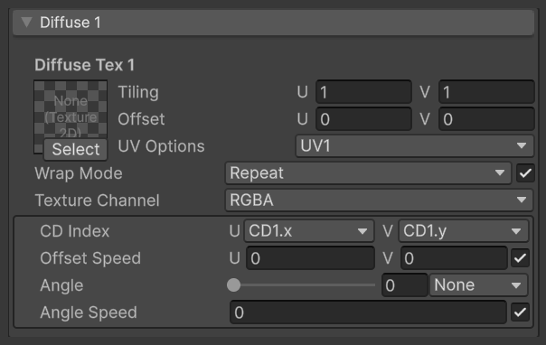
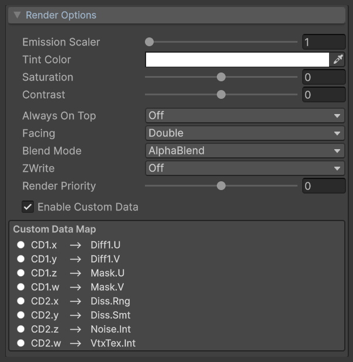
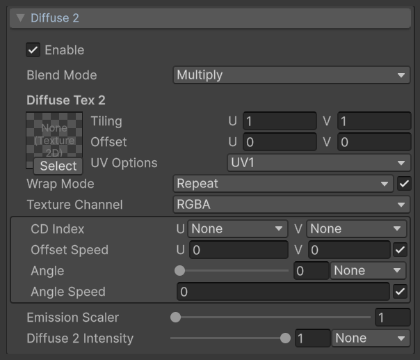
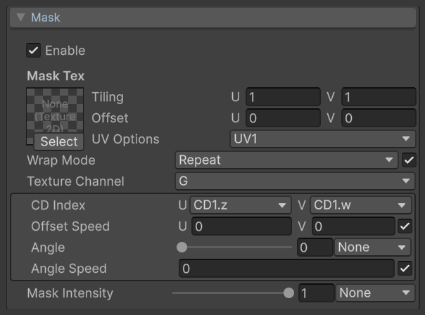
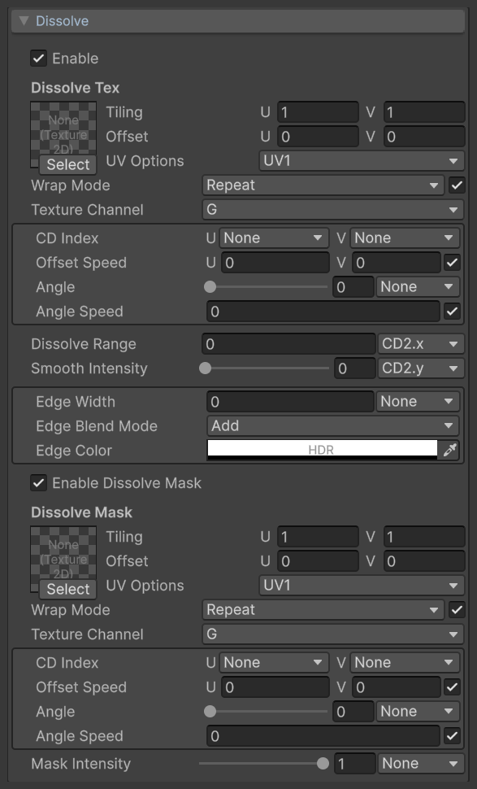
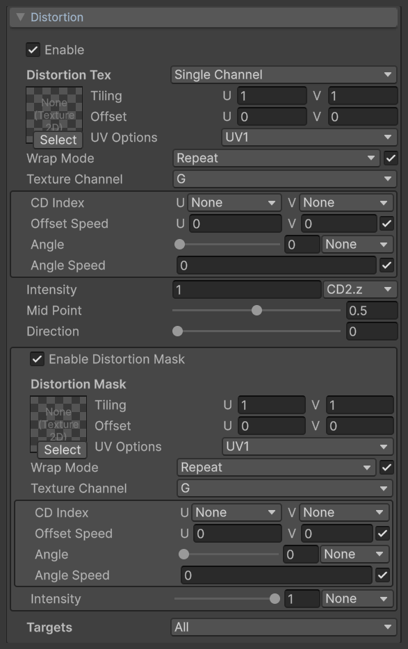
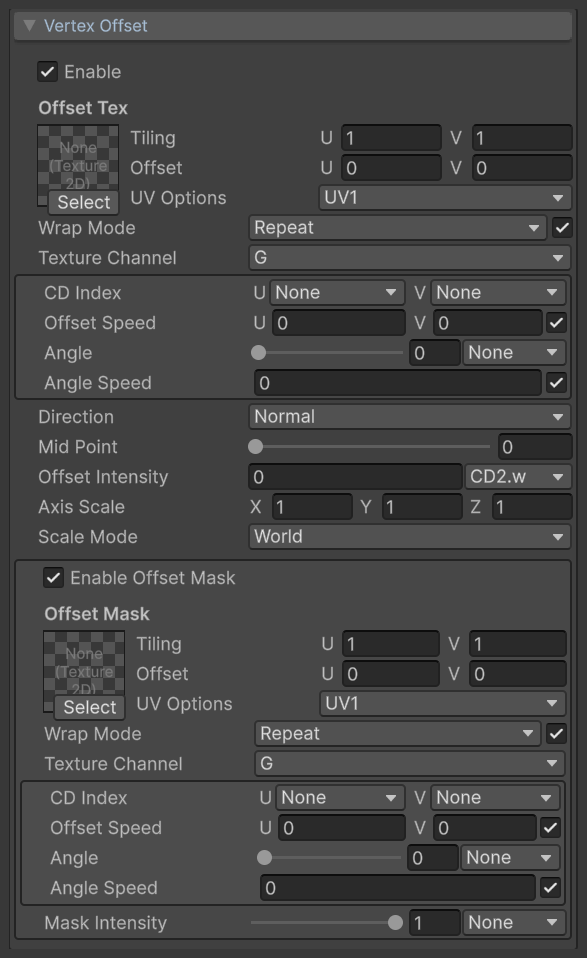
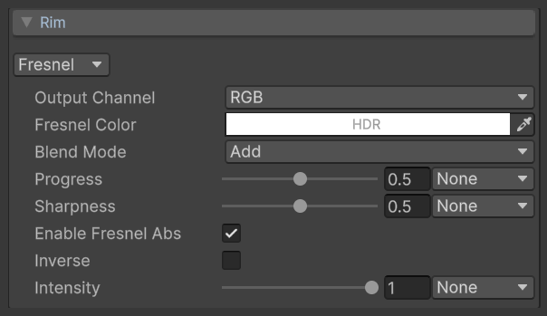
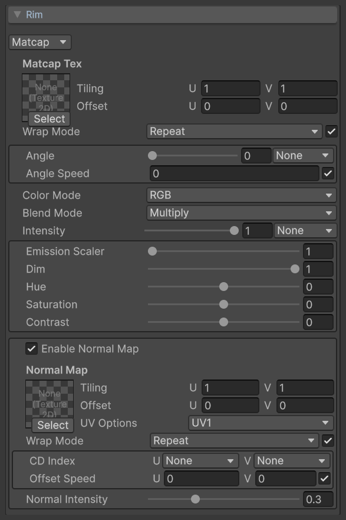
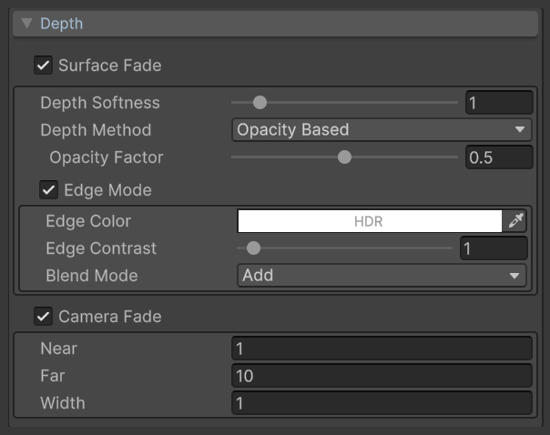

# VFX Essential Shader：Unity 特效用多功能 Shader

[](LICENSE.md)
[](#环境要求)
[](#环境要求)

**文档** ([English](README.md), [日本語](README_JA.md), [中文](README_ZH.md))

*VFX Essential Shader* 是一款面向 Unity Universal Render Pipeline (URP) 的通用特效 Shader，适用于绝大多数 VFX 制作场合。  
它源自作者在 VFX 制作中积累的经验与理解，并按照业界通行的规范做了优化和调整。

**核心特点**

* **Unlit**：不参与光照计算，更适合风格化特效
* **易用的 UI**：专门为 Artist 搭建了 Inspector 界面
* **搭配 Shuriken**：设计上用于搭配 Shuriken 粒子系统 (Particle System)

主要功能包括双层贴图、溶解、遮罩、UV 扭曲（含 Flow Map）、顶点偏移、边缘光（Fresnel / MatCap）、软粒子与相交边缘、按相机距离淡出，以及可在材质中切换的贴图环绕方式。  
每个功能模块都可以单独启用，未启用的模块不产生运行时开销；大部分参数都可以由 Particle System 的 Custom Data 驱动。

各功能的详细说明请参阅下文。

> [!NOTE]
> 本 Shader 使用 Shader Keyword (`shader_feature`) 切换功能，未针对变体 (Shader Variant) 数量、打包和运行时性能进行优化。如需在项目中使用，请根据项目情况自行调整。
>
> **AI-Friendly**：本 Shader 的原型由作者使用节点式 (Node-based) 工具搭建，本发布版本使用 Claude 进行了重构，并在代码中保留了完整的英文注释。此外还专门准备了一份面向 AI 的交接文档 [AGENTS.md](AGENTS.md)（英文），说明代码的结构、设计思路和注意事项。如果想用 Vibe Coding 的方式修改代码，可以先让你的 AI 阅读这些注释和这份文档。

## 目录

<details>
<summary>详细</summary>

- [设置](#设置)
    - [环境要求](#环境要求)
    - [安装](#安装)
- [使用方法](#使用方法)
    - [贴图导入设置](#贴图导入设置)
    - [启用 Depth Texture](#启用-depth-texture)
    - [创建并指定材质](#创建并指定材质)
- [VFX Essential Shader](#vfx-essential-shader)
    - [通用贴图控件](#通用贴图控件)
    - [Render Options](#render-options)
    - [Diffuse 1](#diffuse-1)
    - [Diffuse 2](#diffuse-2)
    - [Mask](#mask)
    - [Dissolve](#dissolve)
    - [Distortion](#distortion)
    - [Vertex Offset](#vertex-offset)
    - [Rim](#rim)
    - [Depth](#depth)
- [与 Custom Vertex Streams 配合使用](#与-custom-vertex-streams-配合使用)
    - [设置 Custom Data](#设置-custom-data)
    - [设置 Custom Vertex Streams](#设置-custom-vertex-streams)
    - [设置材质属性](#设置材质属性)
- [自动设置 Custom Vertex Streams](#自动设置-custom-vertex-streams)
- [Mesh GPU Instancing](#mesh-gpu-instancing)
- [合成顺序](#合成顺序)
- [限制](#限制)
- [许可证](#许可证)

</details>

## 设置

#### 环境要求
本 Shader 支持以下环境。

* Unity 6 (6000.0 LTS) 及以上
* Universal Render Pipeline 17
* Forward 渲染路径

本文档假定 Universal Render Pipeline 已经设置完成。  
关于 Universal Render Pipeline 的详细信息，请参阅 [Unity 手册](https://docs.unity3d.com/Packages/com.unity.render-pipelines.universal@17.0/manual/)。

#### 安装
按以下步骤安装。

1. 从 [Releases](https://github.com/excifroge/VFX-Essential-Shader/releases) 下载最新的 `.unitypackage`
2. 在 Unity 中选择 Assets > Import Package > Custom Package，选中下载的文件并导入

文件会导入到 `Assets/VFXEssentialShader` 文件夹下。

也可以克隆本仓库，把 `Shaders` 和 `Editor` 两个文件夹复制到工程的 `Assets` 文件夹下的任意位置。

## 使用方法

#### 贴图导入设置
> [!IMPORTANT]
> 要使材质中的 Wrap Mode 正常工作，请把本 Shader 使用的所有贴图的 Import Settings 中的 **Wrap Mode** 统一设置为 **Repeat**。

如果贴图的 Import Settings 使用了其他环绕方式，材质中的 Repeat 将无法正确平铺。  
需要 Clamp 或 Mirror 效果时，请保持 Import Settings 为 Repeat，然后在材质的 Wrap Mode 中选择对应的模式。

#### 启用 Depth Texture
使用 [Depth](#depth) 中的功能（软粒子、相交边缘）时，需要启用 Depth Texture。  
在 URP Asset 的 Inspector 中勾选 **Depth Texture**。

不使用这些功能时不需要此设置。

#### 创建并指定材质
创建一个材质，在 Inspector 的 **Shader** 下拉菜单中选择 **VFX > Essential**。

然后把材质指定给 Particle System 的 Renderer 模块，或指定给 Mesh Renderer。

需要用粒子的 Custom Data 驱动材质参数，或需要第二套 UV 时，请参阅[与 Custom Vertex Streams 配合使用](#与-custom-vertex-streams-配合使用)。

## VFX Essential Shader
VFX Essential Shader 是不受光照影响的多功能 Shader。

要使用它，请把 `VFX/Essential` Shader 指定给材质。  
可在 Inspector 中设置的各属性说明如下。

#### 通用贴图控件
各贴图槽位使用同一组通用控件，个别槽位只显示其中的一部分。这里统一说明，后面各模块的表格中不再重复。

<p align="center">
  <br>
  <font color="grey">通用贴图控件（以 Diffuse 1 为例）</font>
</p>

<table width="100%">
<thead>
<tr><td colspan="3"><b>属性名</b></td><td><b>说明</b></td></tr>
</thead>
<tbody>
<tr><td colspan="3"><b>贴图槽位</b></td><td>
要采样的贴图。
</td></tr>
<tr><td colspan="3"><b>Tiling</b></td><td>
贴图在 U、V 方向上的重复次数。
</td></tr>
<tr><td colspan="3"><b>Offset</b></td><td>
贴图在 U、V 方向上的偏移量。
</td></tr>
<tr><td colspan="3"><b>UV Options</b></td><td>
<p>
采样此贴图使用的 UV，从以下选项中指定。
</p>
<p>
<ul>
<li>UV1: 第一套 UV（默认）</li>
<li>UV2: 第二套 UV</li>
<li>Screen: 屏幕空间 UV，整个屏幕对应 0 到 1</li>
</ul>
</p>
</td></tr>
<tr><td colspan="3"><b>Wrap Mode</b></td><td>
<p>
在材质中覆盖贴图的环绕方式。同一张贴图可以在不同的材质中使用不同的环绕方式，无需复制贴图。
</p>
<p>
<ul>
<li>Repeat: 平铺重复（默认）</li>
<li>Clamp: 超出 0 到 1 范围的部分延伸边缘像素</li>
<li>Mirror: 每次重复时镜像翻转</li>
<li>Mirror Once: 镜像一次，之后延伸边缘像素</li>
<li>Per-axis: 分别为 U 和 V 指定环绕方式</li>
</ul>
</p>
<p>
右侧的复选框用于启用或禁用覆盖。禁用时，贴图使用其 Import Settings 中的环绕方式。<br>
使用此功能时，贴图的 Import Settings 需要满足一定条件，请参阅<a href="#贴图导入设置">贴图导入设置</a>。
</p>
</td></tr>
<tr><td></td><td colspan="2"><b>U / V</b></td><td>
<p>
<b>仅在 Wrap Mode 设置为 Per-axis 时显示。</b>
</p>
<p>
U 方向和 V 方向各自的环绕方式。
</p>
</td></tr>
<tr><td colspan="3"><b>Texture Channel</b></td><td>
<p>
从贴图的哪个通道读取数值：R、G、B 或 A。默认值为 G。
</p>
<p>
Diffuse 1 和 Diffuse 2 的 Texture Channel 使用另一组选项，请参阅 <a href="#diffuse-1">Diffuse 1</a>。
</p>
</td></tr>
<tr><td colspan="3"><b>CD Index</b></td><td>
用于驱动 U、V 偏移的 Custom Data 通道。Custom Data 的值直接加到 UV 偏移上。详情请参阅<a href="#与-custom-vertex-streams-配合使用">与 Custom Vertex Streams 配合使用</a>。
</td></tr>
<tr><td colspan="3"><b>Offset Speed</b></td><td>
<p>
贴图在 U、V 方向上的流动速度，单位为 UV/秒。<br>
右侧的复选框用于启用或禁用流动。
</p>
<p>
Wrap Mode 为 Repeat 或 Mirror 时，流动偏移会按贴图的环绕周期回绕，因此长时间运行后贴图不会因 UV 精度不足而出现马赛克。
</p>
</td></tr>
<tr><td colspan="3"><b>Angle</b></td><td>
<p>
贴图的旋转角度，范围为 0 到 360 度。旋转中心为 UV 的 (0.5, 0.5)。<br>
右侧的下拉菜单指定用于驱动旋转的 Custom Data 通道。Custom Data 的值以度为单位，与此角度相加。
</p>
</td></tr>
<tr><td colspan="3"><b>Angle Speed</b></td><td>
<p>
贴图的自转速度，单位为圈/秒。<br>
右侧的复选框用于启用或禁用自转。
</p>
</td></tr>
</tbody>
</table>

UV 的变换顺序为：旋转，然后是 Tiling 和 Offset，最后加上流动和 Custom Data 的偏移。

#### Render Options
Render Options 控制材质的整体颜色和渲染状态。

<p align="center">
  <br>
  <font color="grey">Render Options</font>
</p>

<table width="100%">
<thead>
<tr><td colspan="3"><b>属性名</b></td><td><b>说明</b></td></tr>
</thead>
<tbody>
<tr><td colspan="3"><b>Emission Scaler</b></td><td>
<p>
最终颜色的亮度倍数，范围为 1 到 50。<br>
值为 1 时保持原始亮度。
</p>
</td></tr>
<tr><td colspan="3"><b>Tint Color</b></td><td>
与贴图颜色和顶点颜色相乘的颜色。Alpha 通道控制整体不透明度。
</td></tr>
<tr><td colspan="3"><b>Saturation</b></td><td>
最终颜色的饱和度，范围为 -1 到 1。0 表示不变，-1 为灰度，1 为两倍饱和度。
</td></tr>
<tr><td colspan="3"><b>Contrast</b></td><td>
最终颜色的对比度，范围为 -1 到 1。0 表示不变。此属性同时作用于 Alpha。
</td></tr>
<tr><td colspan="3"><b>Always On Top</b></td><td>
<p>
设置为 On 时跳过深度测试，材质不会被场景中的其他物体遮挡。
</p>
<p>
设置为 On 时，<a href="#depth">Depth</a> 中的 Surface Fade 和 Edge Mode 不可用。
</p>
</td></tr>
<tr><td colspan="3"><b>Facing</b></td><td>
<p>
渲染哪些面，从以下选项中指定。
</p>
<p>
<ul>
<li>Double: 双面（默认）</li>
<li>Front: 仅正面</li>
<li>Back: 仅背面</li>
</ul>
</p>
<p>
<a href="#rim">Rim</a> 设置为 Matcap 时，此属性锁定为 Front。
</p>
</td></tr>
<tr><td colspan="3"><b>Blend Mode</b></td><td>
<p>
颜色的混合方式，从以下选项中指定。
</p>
<p>
<ul>
<li>AlphaBlend: Alpha 混合（默认）</li>
<li>Add: 叠加</li>
</ul>
</p>
</td></tr>
<tr><td colspan="3"><b>ZWrite</b></td><td>
是否写入深度缓冲区。
</td></tr>
<tr><td colspan="3"><b>Render Priority</b></td><td>
<p>
渲染顺序的微调值，范围为 -50 到 50。<br>
材质的 Render Queue 为 3000 + Render Priority，值越大越晚渲染。
</p>
</td></tr>
<tr><td colspan="3"><b>Enable Custom Data</b></td><td>
<p>
启用后，材质从粒子的 Custom Vertex Streams 读取 Custom Data 和 UV2。<br>
详情请参阅<a href="#与-custom-vertex-streams-配合使用">与 Custom Vertex Streams 配合使用</a>。
</p>
</td></tr>
<tr><td></td><td colspan="2"><b>Custom Data Map</b></td><td>
<p>
<b>仅在启用 Enable Custom Data 时显示。</b>
</p>
<p>
列出每个 Custom Data 通道当前驱动的参数。<br>
同一个通道被多个参数使用时，以红色显示警告。
</p>
</td></tr>
</tbody>
</table>

#### Diffuse 1
Diffuse 1 是材质的基础颜色贴图。

<p align="center">
  <br>
  <font color="grey">Diffuse 1</font>
</p>

<table width="100%">
<thead>
<tr><td colspan="3"><b>属性名</b></td><td><b>说明</b></td></tr>
</thead>
<tbody>
<tr><td colspan="3"><b>Diffuse Tex 1</b></td><td>
基础颜色贴图。
</td></tr>
<tr><td></td><td colspan="2"><b>Texture Channel</b></td><td>
<p>
贴图的哪些通道用作颜色和 Alpha，从以下选项中指定。
</p>
<p>
<ul>
<li>RGBA: RGB 用作颜色，A 用作 Alpha（默认）</li>
<li>RGB: RGB 用作颜色，不使用贴图的 Alpha</li>
<li>R: R 通道的灰度用作颜色，不使用贴图的 Alpha</li>
<li>A: A 通道用作 Alpha，不使用贴图的颜色</li>
<li>R2A: R 通道用作 Alpha，不使用贴图的颜色</li>
</ul>
</p>
<p>
未使用的一项取对混合结果没有影响的值：未启用 Diffuse 2 或其 Blend Mode 为 Multiply 时为 1（颜色为白色，Alpha 为 1），Diffuse 2 已启用且其 Blend Mode 为 Add 时为 0。详情请参阅 <a href="#diffuse-2">Diffuse 2</a>。
</p>
</td></tr>
</tbody>
</table>

#### Diffuse 2
Diffuse 2 在基础颜色上叠加第二层贴图。

<p align="center">
  <br>
  <font color="grey">Diffuse 2</font>
</p>

<table width="100%">
<thead>
<tr><td colspan="3"><b>属性名</b></td><td><b>说明</b></td></tr>
</thead>
<tbody>
<tr><td colspan="3"><b>Enable</b></td><td>
启用第二层贴图。
</td></tr>
<tr><td colspan="3"><b>Blend Mode</b></td><td>
<p>
第二层与基础颜色的混合方式，从以下选项中指定。
</p>
<p>
<ul>
<li>Multiply: 与基础颜色相乘（默认）</li>
<li>Add: 加到基础颜色上</li>
</ul>
</p>
<p>
参与混合的是颜色、Alpha 还是两者，由 Texture Channel 决定。组合结果请参阅下表。
</p>
</td></tr>
<tr><td colspan="3"><b>Diffuse Tex 2</b></td><td>
第二层贴图。
</td></tr>
<tr><td></td><td colspan="2"><b>Texture Channel</b></td><td>
<p>
贴图的哪些通道用作颜色和 Alpha。选项与 <a href="#diffuse-1">Diffuse 1</a> 的 Texture Channel 相同，默认值为 RGBA。
</p>
<p>
未使用的一项取对混合结果没有影响的值：Blend Mode 为 Multiply 时为 1，为 Add 时为 0。
</p>
</td></tr>
<tr><td colspan="3"><b>Emission Scaler</b></td><td>
<p>
第二层颜色的亮度倍数，范围为 1 到 50。<br>
值为 1 时保持原始亮度。
</p>
</td></tr>
<tr><td colspan="3"><b>Diffuse 2 Intensity</b></td><td>
第二层的强度，范围为 0 到 1。可由 Custom Data 驱动。
</td></tr>
</tbody>
</table>

Texture Channel 和 Blend Mode 的组合结果如下。

<table width="100%">
<thead>
<tr><td><b>Texture Channel</b></td><td><b>Multiply</b></td><td><b>Add</b></td></tr>
</thead>
<tbody>
<tr><td><b>RGBA</b></td><td>颜色相乘，Alpha 相乘</td><td>以第二层的 Alpha 为权重，颜色相加；并把第二层的 Alpha 加到 Alpha 上</td></tr>
<tr><td><b>RGB</b></td><td>颜色相乘</td><td>颜色相加</td></tr>
<tr><td><b>R</b></td><td>R 通道的灰度与颜色相乘</td><td>把 R 通道的灰度加到颜色上</td></tr>
<tr><td><b>A</b></td><td>A 通道与 Alpha 相乘</td><td>把 A 通道加到 Alpha 上</td></tr>
<tr><td><b>R2A</b></td><td>R 通道与 Alpha 相乘</td><td>把 R 通道加到 Alpha 上</td></tr>
</tbody>
</table>

Add 模式下，相加后的 Alpha 不超过 1。

上表是第二层一侧的结果。Diffuse 1 中未使用的一项同样取对混合结果没有影响的值，因此可以让两层分别提供颜色和 Alpha。
例如 Diffuse 1 为 RGB、Diffuse 2 为 A 时，无论 Blend Mode 是 Multiply 还是 Add，颜色都来自 Diffuse 1，Alpha 都来自 Diffuse 2。

两层都未使用的一项，最终值为 1：颜色为白色，Alpha 为 1。

#### Mask
Mask 用一张贴图控制不透明度。

<p align="center">
  <br>
  <font color="grey">Mask</font>
</p>

<table width="100%">
<thead>
<tr><td colspan="3"><b>属性名</b></td><td><b>说明</b></td></tr>
</thead>
<tbody>
<tr><td colspan="3"><b>Enable</b></td><td>
启用遮罩。
</td></tr>
<tr><td colspan="3"><b>Mask Tex</b></td><td>
遮罩贴图。所选通道的值与 Alpha 相乘。
</td></tr>
<tr><td colspan="3"><b>Mask Intensity</b></td><td>
遮罩的强度，范围为 0 到 1。0 表示遮罩不起作用。可由 Custom Data 驱动。
</td></tr>
</tbody>
</table>

#### Dissolve
Dissolve 根据一张贴图逐渐溶解材质，并可在溶解边界显示边缘颜色。

<p align="center">
  <br>
  <font color="grey">Dissolve</font>
</p>

<table width="100%">
<thead>
<tr><td colspan="3"><b>属性名</b></td><td><b>说明</b></td></tr>
</thead>
<tbody>
<tr><td colspan="3"><b>Enable</b></td><td>
启用溶解。
</td></tr>
<tr><td colspan="3"><b>Dissolve Tex</b></td><td>
溶解贴图。所选通道的值越小，越早被溶解。
</td></tr>
<tr><td colspan="3"><b>Dissolve Range</b></td><td>
<p>
溶解的进度。贴图值低于此值的区域被溶解。<br>
可由 Custom Data 驱动，默认绑定到 CD2.x。
</p>
</td></tr>
<tr><td colspan="3"><b>Smooth Intensity</b></td><td>
<p>
溶解边界的过渡宽度，范围为 0 到 1。0 表示硬边。<br>
可由 Custom Data 驱动，默认绑定到 CD2.y。
</p>
</td></tr>
<tr><td colspan="3"><b>Edge Width</b></td><td>
边缘带的宽度。0 表示没有边缘带。可由 Custom Data 驱动。
</td></tr>
<tr><td colspan="3"><b>Edge Blend Mode</b></td><td>
<p>
边缘带的显示方式，从以下选项中指定。
</p>
<p>
<ul>
<li>Add: 把边缘颜色加到材质颜色上（默认）</li>
<li>Multiply: 把边缘颜色与材质颜色相乘</li>
<li>Tint: 用边缘颜色覆盖材质颜色。覆盖的颜色不受 Tint Color 和顶点颜色影响</li>
<li>Select: 仅保留边缘带，其余部分全部剔除</li>
</ul>
</p>
</td></tr>
<tr><td></td><td colspan="2"><b>Edge Color</b></td><td>
<p>
<b>Edge Blend Mode 设置为 Select 时不显示。</b>
</p>
<p>
边缘带的颜色 (HDR)。Alpha 通道控制边缘颜色的强度。<br>
Edge Blend Mode 为 Tint 时，Alpha 通道控制边缘带的不透明度。
</p>
</td></tr>
<tr><td colspan="3"><b>Enable Dissolve Mask</b></td><td>
启用溶解遮罩。
</td></tr>
<tr><td></td><td colspan="2"><b>Dissolve Mask</b></td><td>
溶解遮罩贴图。所选通道的值越大，该区域越晚被溶解。
</td></tr>
<tr><td></td><td colspan="2"><b>Mask Intensity</b></td><td>
溶解遮罩的强度，范围为 0 到 1。可由 Custom Data 驱动。
</td></tr>
</tbody>
</table>

Smooth Intensity 或 Edge Width 大于 0 时，Dissolve Range 为 0 的状态下，溶解贴图中较暗的区域已经会出现过渡或边缘带。  
如果需要从完全未溶解的状态开始，请把 Dissolve Range 的起始值设置为负数。

#### Distortion
Distortion 用一张贴图扭曲其他贴图的 UV。

<p align="center">
  <br>
  <font color="grey">Distortion</font>
</p>

<table width="100%">
<thead>
<tr><td colspan="3"><b>属性名</b></td><td><b>说明</b></td></tr>
</thead>
<tbody>
<tr><td colspan="3"><b>Enable</b></td><td>
启用扭曲。
</td></tr>
<tr><td colspan="3"><b>Distortion Tex</b></td><td>
<p>
扭曲贴图。标题右侧的下拉菜单选择贴图的类型。
</p>
<p>
<ul>
<li>Single Channel: 使用单个通道的灰度，沿 Direction 指定的方向扭曲（默认）</li>
<li>Flow Map: 使用两个通道分别作为 U 和 V 方向的扭曲量</li>
</ul>
</p>
</td></tr>
<tr><td></td><td colspan="2"><b>Texture Channel</b></td><td>
<p>
<b>仅在类型为 Single Channel 时显示。</b>
</p>
<p>
用作扭曲量的通道。
</p>
</td></tr>
<tr><td></td><td colspan="2"><b>Channels</b></td><td>
<p>
<b>仅在类型为 Flow Map 时显示。</b>
</p>
<p>
分别用作 U 和 V 方向扭曲量的通道。
</p>
</td></tr>
<tr><td colspan="3"><b>Intensity</b></td><td>
扭曲的强度。可由 Custom Data 驱动，默认绑定到 CD2.z。
</td></tr>
<tr><td colspan="3"><b>Mid Point</b></td><td>
<p>
<b>仅在类型为 Single Channel 时显示。</b>
</p>
<p>
贴图中表示"不扭曲"的灰度值，范围为 0 到 1，默认值为 0.5。
</p>
</td></tr>
<tr><td colspan="3"><b>Direction</b></td><td>
<p>
<b>仅在类型为 Single Channel 时显示。</b>
</p>
<p>
扭曲的方向，范围为 0 到 360 度。
</p>
</td></tr>
<tr><td colspan="3"><b>Enable Distortion Mask</b></td><td>
启用扭曲遮罩。
</td></tr>
<tr><td></td><td colspan="2"><b>Distortion Mask</b></td><td>
扭曲遮罩贴图。所选通道的值与扭曲强度相乘。
</td></tr>
<tr><td></td><td colspan="2"><b>Intensity</b></td><td>
扭曲遮罩的强度，范围为 0 到 1。可由 Custom Data 驱动。
</td></tr>
<tr><td colspan="3"><b>Targets</b></td><td>
<p>
扭曲作用于哪些贴图，可多选。
</p>
<p>
<ul>
<li>Diffuse 1</li>
<li>Diffuse 2</li>
<li>Mask</li>
<li>Dissolve</li>
<li>Dissolve Mask</li>
<li>Vertex Offset: <a href="#vertex-offset">Vertex Offset</a> 的 Offset Tex</li>
<li>Offset Mask: <a href="#vertex-offset">Vertex Offset</a> 的 Offset Mask</li>
</ul>
</p>
<p>
默认全选。
</p>
</td></tr>
</tbody>
</table>

扭曲量在目标贴图的旋转和 Tiling 之前加到 UV 上。  
因此，多个目标贴图即使旋转角度和 Tiling 各不相同，受到的扭曲在网格表面上也是一致的。

Targets 中选择了 Vertex Offset 或 Offset Mask，且 Vertex Offset 已启用时，扭曲贴图会在顶点着色器中额外采样，扭曲量按顶点计算。

#### Vertex Offset
Vertex Offset 根据一张贴图在顶点着色器中移动顶点。

<p align="center">
  <br>
  <font color="grey">Vertex Offset</font>
</p>

<table width="100%">
<thead>
<tr><td colspan="3"><b>属性名</b></td><td><b>说明</b></td></tr>
</thead>
<tbody>
<tr><td colspan="3"><b>Enable</b></td><td>
启用顶点偏移。
</td></tr>
<tr><td colspan="3"><b>Offset Tex</b></td><td>
偏移贴图。所选通道的值决定每个顶点的偏移量。
</td></tr>
<tr><td colspan="3"><b>Direction</b></td><td>
<p>
顶点的偏移方向，从以下选项中指定。
</p>
<p>
<ul>
<li>Normal: 沿各顶点的法线（默认）</li>
<li>World: 沿 Axis Scale 指定的世界空间方向</li>
</ul>
</p>
</td></tr>
<tr><td colspan="3"><b>Mid Point</b></td><td>
<p>
贴图中表示"不偏移"的值，范围为 0 到 1，默认值为 0。<br>
贴图值大于此值时正向偏移，小于此值时反向偏移。
</p>
</td></tr>
<tr><td colspan="3"><b>Offset Intensity</b></td><td>
偏移的强度。可由 Custom Data 驱动，默认绑定到 CD2.w。
</td></tr>
<tr><td colspan="3"><b>Axis Scale</b></td><td>
<p>
Direction 为 Normal 时，表示偏移在 X、Y、Z 各轴上的缩放。
</p>
<p>
Direction 为 World 时，表示偏移的方向向量。此向量不会被归一化，其长度同时影响偏移量。
</p>
</td></tr>
<tr><td></td><td colspan="2"><b>Scale Mode</b></td><td>
<p>
<b>仅在 Direction 设置为 Normal 时显示。</b>
</p>
<p>
Axis Scale 的 X、Y、Z 所对应的坐标轴：World（世界空间）或 Local（对象空间）。
</p>
</td></tr>
<tr><td colspan="3"><b>Enable Offset Mask</b></td><td>
启用偏移遮罩。
</td></tr>
<tr><td></td><td colspan="2"><b>Offset Mask</b></td><td>
偏移遮罩贴图。所选通道的值与偏移量相乘。
</td></tr>
<tr><td></td><td colspan="2"><b>Mask Intensity</b></td><td>
偏移遮罩的强度，范围为 0 到 1。可由 Custom Data 驱动。
</td></tr>
</tbody>
</table>

每个顶点的偏移量按以下方式计算。

```
偏移量 = (Offset Tex 的值 - Mid Point) × Offset Intensity × Offset Mask
```

#### Rim
Rim 为材质添加基于视角的效果。  
通过标题下方的下拉菜单选择模式：Off、Fresnel 或 Matcap。

##### Fresnel
Fresnel 根据表面法线与视线的夹角生成边缘光。

<p align="center">
  <br>
  <font color="grey">Rim（Fresnel）</font>
</p>

<table width="100%">
<thead>
<tr><td colspan="3"><b>属性名</b></td><td><b>说明</b></td></tr>
</thead>
<tbody>
<tr><td colspan="3"><b>Output Channel</b></td><td>
<p>
Fresnel 的输出方式，从以下选项中指定。
</p>
<p>
<ul>
<li>RGB: 作为颜色叠加到材质上（默认）</li>
<li>A: 与 Alpha 相乘，用于让材质的中心或边缘变透明</li>
</ul>
</p>
</td></tr>
<tr><td></td><td colspan="2"><b>Fresnel Color</b></td><td>
<p>
<b>仅在 Output Channel 设置为 RGB 时显示。</b>
</p>
<p>
边缘光的颜色 (HDR)。Alpha 通道控制边缘光的强度。
</p>
</td></tr>
<tr><td></td><td colspan="2"><b>Blend Mode</b></td><td>
<p>
<b>仅在 Output Channel 设置为 RGB 时显示。</b>
</p>
<p>
边缘光与材质颜色的混合方式：Add（相加）、Multiply（相乘）或 Tint（覆盖）。
</p>
</td></tr>
<tr><td colspan="3"><b>Progress</b></td><td>
<p>
边缘光的覆盖范围，范围为 0 到 1。<br>
0 表示覆盖整个表面，值越大越向轮廓收缩，1 表示完全消失。可由 Custom Data 驱动。
</p>
</td></tr>
<tr><td colspan="3"><b>Sharpness</b></td><td>
边缘光边界的锐度，范围为 0 到 1。1 表示硬边。可由 Custom Data 驱动。
</td></tr>
<tr><td colspan="3"><b>Enable Fresnel Abs</b></td><td>
启用后，背面也产生与正面相同的边缘光。双面渲染时建议启用。默认为启用。
</td></tr>
<tr><td colspan="3"><b>Inverse</b></td><td>
反转边缘光，使其出现在表面的中心而不是轮廓。
</td></tr>
<tr><td colspan="3"><b>Intensity</b></td><td>
边缘光的强度，范围为 0 到 1。可由 Custom Data 驱动。
</td></tr>
</tbody>
</table>

Output Channel 为 RGB 时，边缘光在 Tint Color 和顶点颜色之后合成，其颜色不受这两者影响。

##### Matcap
Matcap 根据视图空间中的法线方向采样一张 MatCap 贴图。

<p align="center">
  <br>
  <font color="grey">Rim（Matcap）</font>
</p>

<table width="100%">
<thead>
<tr><td colspan="3"><b>属性名</b></td><td><b>说明</b></td></tr>
</thead>
<tbody>
<tr><td colspan="3"><b>Matcap Tex</b></td><td>
MatCap 贴图。
</td></tr>
<tr><td colspan="3"><b>Angle</b></td><td>
MatCap 贴图的旋转角度，范围为 0 到 360 度。可由 Custom Data 驱动。
</td></tr>
<tr><td colspan="3"><b>Angle Speed</b></td><td>
<p>
MatCap 贴图的自转速度，单位为圈/秒。<br>
右侧的复选框用于启用或禁用自转。
</p>
</td></tr>
<tr><td colspan="3"><b>Color Mode</b></td><td>
<p>
使用 MatCap 贴图的哪些信息，从以下选项中指定。
</p>
<p>
<ul>
<li>RGB: 使用颜色（默认）</li>
<li>Grayscale: 把颜色转换为灰度后使用</li>
<li>RGBA: 使用颜色和 Alpha</li>
<li>RGBtoA: 把颜色转换为灰度，仅用于影响材质的 Alpha，不改变材质的颜色</li>
</ul>
</p>
</td></tr>
<tr><td colspan="3"><b>Blend Mode</b></td><td>
<p>
MatCap 与材质的混合方式：Multiply（默认）或 Add。<br>
与 Color Mode 的组合结果请参阅下表。
</p>
</td></tr>
<tr><td colspan="3"><b>Intensity</b></td><td>
MatCap 的强度，范围为 0 到 1。可由 Custom Data 驱动。
</td></tr>
<tr><td colspan="3"><b>Emission Scaler</b></td><td>
MatCap 颜色的亮度倍数，范围为 1 到 50。值为 1 时保持原始亮度。
</td></tr>
<tr><td colspan="3"><b>Dim</b></td><td>
<p>
<b>仅在 Blend Mode 设置为 Multiply 时显示。</b>
</p>
<p>
MatCap 颜色的压暗系数，范围为 0 到 1。
</p>
</td></tr>
<tr><td colspan="3"><b>Hue</b></td><td>
MatCap 颜色的色相偏移，范围为 -180 到 180 度。
</td></tr>
<tr><td colspan="3"><b>Saturation</b></td><td>
MatCap 颜色的饱和度，范围为 -1 到 1。0 表示不变。
</td></tr>
<tr><td colspan="3"><b>Contrast</b></td><td>
MatCap 颜色的对比度，范围为 -1 到 1。0 表示不变。
</td></tr>
<tr><td colspan="3"><b>Enable Normal Map</b></td><td>
<p>
启用法线贴图，用于扰动采样 MatCap 时使用的法线。
</p>
<p>
切线方向由 Shader 逐像素计算，用于 Particle System 时不需要添加 Tangent Vertex Stream。
</p>
</td></tr>
<tr><td></td><td colspan="2"><b>Normal Map</b></td><td>
切线空间法线贴图。支持 CD Index 和 Offset Speed，不支持旋转。
</td></tr>
<tr><td></td><td colspan="2"><b>Normal Intensity</b></td><td>
法线贴图的强度，范围为 0 到 1，默认值为 0.3。
</td></tr>
</tbody>
</table>

Color Mode 和 Blend Mode 的组合结果如下。

<table width="100%">
<thead>
<tr><td><b>Color Mode</b></td><td><b>Multiply</b></td><td><b>Add</b></td></tr>
</thead>
<tbody>
<tr><td><b>RGB / Grayscale</b></td><td>颜色相乘</td><td>颜色相加</td></tr>
<tr><td><b>RGBA</b></td><td>颜色相乘，Alpha 相乘</td><td>颜色相加，并把 MatCap 的 Alpha 加到 Alpha 上</td></tr>
<tr><td><b>RGBtoA</b></td><td>灰度与 Alpha 相乘</td><td>把灰度加到 Alpha 上</td></tr>
</tbody>
</table>

Rim 设置为 Matcap 时，Render Options 中的 Facing 锁定为 Front。切换到其他模式后恢复为之前的设置。

#### Depth
Depth 包含基于深度的效果。其中 Surface Fade 和 Edge Mode 需要[启用 Depth Texture](#启用-depth-texture)，Camera Fade 不需要。

Render Options 中的 Always On Top 设置为 On 时，Surface Fade 和 Edge Mode 不可用。

<p align="center">
  <br>
  <font color="grey">Depth</font>
</p>

<table width="100%">
<thead>
<tr><td colspan="3"><b>属性名</b></td><td><b>说明</b></td></tr>
</thead>
<tbody>
<tr><td colspan="3"><b>Surface Fade</b></td><td>
启用后，材质在靠近场景中不透明表面的位置逐渐淡出，避免粒子与几何体相交处出现硬边（软粒子）。
</td></tr>
<tr><td></td><td colspan="2"><b>Depth Softness</b></td><td>
<p>
淡出的距离，范围为 0.01 到 10。值越大，淡出的范围越大。<br>
启用 Edge Mode 时，此属性决定相交边缘的范围。
</p>
</td></tr>
<tr><td></td><td colspan="2"><b>Depth Method</b></td><td>
<p>
淡出距离的计算方式，从以下选项中指定。
</p>
<p>
<ul>
<li>Simple: 所有像素使用相同的 Depth Softness（默认）</li>
<li>Opacity Based: 越透明的像素使用越长的淡出距离</li>
</ul>
</p>
</td></tr>
<tr><td></td><td></td><td><b>Opacity Factor</b></td><td>
<p>
<b>仅在 Depth Method 设置为 Opacity Based 时显示。</b>
</p>
<p>
透明像素的淡出距离的延长程度，范围为 0 到 1。
</p>
</td></tr>
<tr><td></td><td colspan="2"><b>Edge Mode</b></td><td>
启用后，材质在与场景表面相交的位置显示边缘颜色，而不是淡出。
</td></tr>
<tr><td></td><td></td><td><b>Edge Color</b></td><td>
相交边缘的颜色 (HDR)。Alpha 通道控制边缘的强度。
</td></tr>
<tr><td></td><td></td><td><b>Edge Contrast</b></td><td>
相交边缘的衰减，范围为 0.1 到 20。值越大，边缘越宽、越饱满；值越小，边缘越细、衰减越快。
</td></tr>
<tr><td></td><td></td><td><b>Blend Mode</b></td><td>
<p>
边缘颜色与材质颜色的混合方式：Add（相加）、Multiply（相乘）或 Tint（覆盖）。<br>
Tint 模式的边缘颜色不受 Saturation 和 Contrast 影响。
</p>
</td></tr>
<tr><td colspan="3"><b>Camera Fade</b></td><td>
启用后，材质根据与相机的距离淡出。
</td></tr>
<tr><td></td><td colspan="2"><b>Near</b></td><td>
与相机的距离小于此值的部分完全透明。
</td></tr>
<tr><td></td><td colspan="2"><b>Far</b></td><td>
与相机的距离大于此值的部分完全透明。
</td></tr>
<tr><td></td><td colspan="2"><b>Width</b></td><td>
在 Near 和 Far 两端淡入淡出的过渡距离。
</td></tr>
</tbody>
</table>

相交边缘在贴图透明的区域同样可见，但会随粒子的淡出、溶解和遮罩一起消失。  
启用 Edge Mode 时，相交边缘处的 Fresnel 边缘光会被抑制。

## 与 Custom Vertex Streams 配合使用
通过 Particle System 的 Custom Vertex Streams，可以用 Custom Data 驱动材质参数，并使用第二套 UV。

用于 Mesh Renderer 时不需要这些设置，请保持 Enable Custom Data 为禁用状态。此时 UV2 取自网格的第二套 UV。

#### 设置 Custom Data
在 Particle System 的 Custom Data 模块中，把 Custom1 和 Custom2 的 Mode 设置为 Vector，并把分量数设置为 4。

#### 设置 Custom Vertex Streams
在 Particle System 的 Renderer 模块中启用 Custom Vertex Streams，并按下表的顺序设置。

<table width="100%">
<thead>
<tr><td><b>顺序</b></td><td><b>Vertex Stream</b></td><td><b>语义</b></td><td><b>用途</b></td></tr>
</thead>
<tbody>
<tr><td>1</td><td>Position</td><td>POSITION</td><td>顶点位置</td></tr>
<tr><td>2</td><td>Normal</td><td>NORMAL</td><td>法线。Rim 和 Vertex Offset 需要</td></tr>
<tr><td>3</td><td>Color</td><td>COLOR</td><td>粒子颜色</td></tr>
<tr><td>4</td><td>UV</td><td>TEXCOORD0.xy</td><td>第一套 UV (UV1)</td></tr>
<tr><td>5</td><td>UV2</td><td>TEXCOORD0.zw</td><td>第二套 UV (UV2)</td></tr>
<tr><td>6</td><td>Custom1.xyzw</td><td>TEXCOORD1.xyzw</td><td>Custom Data 1 (CD1)</td></tr>
<tr><td>7</td><td>Custom2.xyzw</td><td>TEXCOORD2.xyzw</td><td>Custom Data 2 (CD2)</td></tr>
</tbody>
</table>

在占用 TEXCOORD 的 Vertex Stream 中，UV、UV2、Custom1、Custom2 必须按上表的顺序排在最前面，其他占用 TEXCOORD 的 Vertex Stream 只能排在它们之后。  
顺序不一致时 Unity 不会报错，但材质会读到错误的数据。

#### 设置材质属性
在材质的 Render Options 中启用 Enable Custom Data。

之后，带有 Custom Data 下拉菜单的参数就可以由 Custom Data 驱动。  
下拉菜单中的 CD1.x 到 CD1.w 对应 Custom1 的 X、Y、Z、W，CD2.x 到 CD2.w 对应 Custom2 的 X、Y、Z、W，None 表示不使用 Custom Data。

参数的最终值为材质中设置的值与 Custom Data 的值之和。

```
最终值 = 材质中的值 + Custom Data 的值
```

因此，Particle System 的 Custom Data 保持为 0 时，启用或禁用 Enable Custom Data 不会改变材质的外观。  
如果希望某个参数完全由 Custom Data 控制，请把材质中的对应值设置为 0。

范围为 0 到 1 的强度类参数，相加后的结果会被限制在 0 到 1 之间。Dissolve Mask 的 Mask Intensity 和 Fresnel 的各项参数除外。

以下参数默认绑定了 Custom Data 通道。

<table width="100%">
<thead>
<tr><td><b>Custom Data 通道</b></td><td><b>默认驱动的参数</b></td></tr>
</thead>
<tbody>
<tr><td>CD1.x</td><td>Diffuse Tex 1 的 U 偏移</td></tr>
<tr><td>CD1.y</td><td>Diffuse Tex 1 的 V 偏移</td></tr>
<tr><td>CD1.z</td><td>Mask Tex 的 U 偏移</td></tr>
<tr><td>CD1.w</td><td>Mask Tex 的 V 偏移</td></tr>
<tr><td>CD2.x</td><td>Dissolve Range</td></tr>
<tr><td>CD2.y</td><td>Smooth Intensity</td></tr>
<tr><td>CD2.z</td><td>Distortion 的 Intensity</td></tr>
<tr><td>CD2.w</td><td>Offset Intensity</td></tr>
</tbody>
</table>

## 自动设置 Custom Vertex Streams
启用 Enable Custom Data 后，如果场景中使用此材质的 Particle System 的 Vertex Stream 与要求不一致，材质的 Inspector 会显示警告。  
使用 [Mesh GPU Instancing](#mesh-gpu-instancing) 的 Particle System，无论是否启用 Enable Custom Data 都会进行检查。

点击 **Fix Vertex Streams** 按钮可自动修正：必需的 Vertex Stream 按顺序排在前面，原有的其他 Vertex Stream 保留在后面。  
对于使用 Mesh GPU Instancing 的 Particle System，逐粒子的 Vertex Stream 会被替换为所需的内容，其他逐粒子的 Vertex Stream 会被移除。

## Mesh GPU Instancing
Particle System 的 Render Mode 为 Mesh，且 Renderer 模块中启用了 Enable Mesh GPU Instancing 时，本 Shader 自动以 GPU Instancing 渲染粒子。不需要在材质中进行任何设置。

使用 Mesh GPU Instancing 时，Position、Normal、UV、UV2 等来自网格自身的顶点数据，其余的 Vertex Stream 则逐粒子提供。
启用了 Custom Vertex Streams 时，逐粒子的 Vertex Stream 必须与下表完全一致，包括顺序，且不能包含其他逐粒子的 Vertex Stream。

<table width="100%">
<thead>
<tr><td><b>Enable Custom Data</b></td><td><b>逐粒子的 Vertex Stream</b></td></tr>
</thead>
<tbody>
<tr><td>禁用</td><td>Color, AnimFrame</td></tr>
<tr><td>启用</td><td>Color, Custom1.xyzw, Custom2.xyzw, AnimFrame</td></tr>
</tbody>
</table>

Renderer 模块未启用 Custom Vertex Streams，且 Enable Custom Data 为禁用状态时，无需进行设置。

Vertex Stream 不一致时 Unity 不会报错，但材质会读到错误的数据。可以通过 Inspector 中的 [Fix Vertex Streams](#自动设置-custom-vertex-streams) 按钮修正。

使用 Mesh GPU Instancing 时，Texture Sheet Animation 仅作用于 UV1。

## 合成顺序
Shader 按以下顺序计算最终颜色。

1. 计算 Distortion 的扭曲量
2. 采样 Diffuse 1，并混合 Diffuse 2
3. 应用 Dissolve 和 Mask
4. 应用 Rim（Fresnel 的 A 输出，或 Matcap）
5. 与顶点颜色、Tint Color 相乘，并应用 Emission Scaler
6. 应用 Dissolve 的 Tint 边缘颜色
7. 应用 Fresnel 的 RGB 输出
8. 应用 Surface Fade，或 Edge Mode 的 Add、Multiply 边缘颜色
9. 应用 Saturation 和 Contrast
10. 应用 Edge Mode 的 Tint 边缘颜色
11. 应用 Camera Fade

## 限制
* 不支持雾效 (Fog)
* 不支持 Texture Sheet Animation 的帧间混合
* 不支持 UI 的 Mask 和 RectMask2D
* 不支持 XR 的单通道实例化渲染 (Single Pass Instanced)

## 许可证
本软件以 MIT 许可证发布。  
在许可证允许的范围内可以自由使用，使用时必须保留以下著作权声明和许可声明。

* [LICENSE.md](LICENSE.md)
